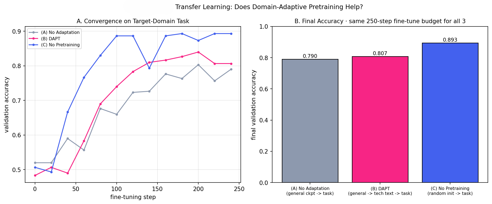
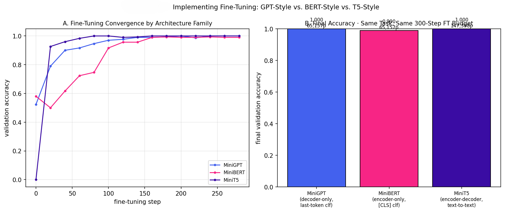

<div align="center">


</div>

---

## Table of Contents

- [Overview](#overview)
- [The Arc of This Phase](#the-arc-of-this-phase)
- [Topics at a Glance](#topics-at-a-glance)
- [Folder Structure](#folder-structure)
- [Datasets and Models Used in This Phase](#datasets-and-models-used-in-this-phase)
- [Results Snapshot](#results-snapshot)
- [Highlights Gallery](#highlights-gallery)
- [Getting Started](#getting-started)
- [Known Issues](#known-issues)
- [Key References](#key-references)
- [Navigate](#navigate)
- [License](#license)
- [Author](#author)

---

## Overview

Phase 01 explained how a language model is built and why pretraining produces a useful starting point. Phase 02 starts where pretraining ends: almost nobody uses a pretrained model as-is, so the real engineering question is **what you do to it next**. Every topic here holds one pretrained checkpoint fixed and varies a single decision: *which fine-tuning recipe* (naive, discriminative learning rates, warmup and cosine decay, gradual unfreezing), *which pretraining history* (general, domain-adapted, or none), *which architecture family* (decoder-only, encoder-only, encoder-decoder), and *which downstream tasks* a small model can honestly demonstrate at all. The question the phase answers: **when does each adaptation choice actually help, and when does it not?**

This phase holds itself to the same standard as Phase 01: 3 of 4 topics were executed, and the numbers in this README come from committed result images or from the topic's own measured-results tables, not from expectation. Two of the measured outcomes run against the textbook story and are reported as measured: the "careful" fine-tuning recipes lost to the naive one (2.1), and a randomly initialized model beat both pretrained arms (2.2). Topic 2.4 is the exception: only its theory document is committed (no code, no explanation, no image), and its summarization case study is explicitly not executed. See [Results Snapshot](#results-snapshot) and [Known Issues](#known-issues).

## The Arc of This Phase

**2.1 — Principles and Techniques for Fine-Tuning.** Does a more sophisticated fine-tuning recipe beat plain full fine-tuning? Four byte-identical copies of one MLM-pretrained encoder are fine-tuned with different techniques (flat LR, ULMFiT-style discriminative LRs, warmup plus cosine decay, gradual unfreezing) under an identical step budget on a synthetic sentiment task. The conservative recipes lost on this easy task, which the theory doc explains as a cost of protection → [result](#results-snapshot).

**2.2 — Transfer Learning for Domain-Specific Tasks.** How much does it matter what a model was pretrained on, relative to the domain it is applied to? Three arms share one architecture and one fine-tuning budget: a general checkpoint (A), the same checkpoint plus unlabeled domain-adaptive pretraining (B), and random initialization (C). A real evaluation-protocol bug (the `[CLS]` token was never seen during pretraining) was caught and fixed here, and the write-up documents it → [result](#results-snapshot).

**2.3 — Implementing Fine-Tuning (GPT, BERT, T5).** What does "fine-tune a Transformer for classification" mean structurally for each architecture family? A decoder-only model pools the last real token, an encoder-only model reads `[CLS]`, and an encoder-decoder model generates a label token via cross-attention. The T5-style model reuses the *same* pretrained encoder object as the BERT-style one, so differences come from the method and not from two unrelated encoders. This topic applies the `[CLS]` lesson from 2.2 from the first line → [result](#results-snapshot).

**2.4 — Case Studies: Summarization, Translation, Sentiment.** Which real-world tasks can a toy model demonstrate honestly, and which cannot be faked? Sentiment (with negation as the hard case) and translation (invented languages, to show substitution plus reordering) are treated as small-scale mechanism demonstrations. Abstractive summarization is deliberately not run, because a from-scratch toy decoder would only produce fluent-looking nonsense → [result](#results-snapshot).

## Topics at a Glance

| # | Topic | Folder | What the code actually proves |
|---|-------|--------|--------------------------------|
| 1 | Principles and Techniques for Fine-Tuning | [`01-Fine_Tuning_Principles_and_Techniques`](01-Fine_Tuning_Principles_and_Techniques) | Four fine-tuning recipes from one shared checkpoint, one step budget; the naive recipe wins on an easy task and the cost of "protective" recipes is measurable |
| 2 | Transfer Learning for Domain-Specific Tasks | [`02-Transfer_Learning_for_Domain_Specific_Tasks`](02-Transfer_Learning_for_Domain_Specific_Tasks) | Domain-adaptive pretraining beats no adaptation (0.807 vs 0.790), but random init beats both (0.893) in a data-scarce toy regime |
| 3 | Implementing Fine-Tuning (GPT, BERT, T5) | [`03-Implementing_Fine_Tuning`](03-Implementing_Fine_Tuning) | All three architecture families fine-tune correctly with their own readout mechanics, reaching 0.990 to 1.000 accuracy on the same task and budget |
| 4 | Case Studies: Summarization, Translation, Sentiment | [`04-Case_Studies_Summarization_Translation_Sentiment`](04-Case_Studies_Summarization_Translation_Sentiment) | Theory and scoping only in the repo today: why sentiment and translation are demonstrable at toy scale and summarization is not |

Topics 1 to 3 follow the repository's four-file structure: `README.md` (theory), `implementation.py`, `explanation.md`, and a result image under `Image/`. Topic 1 has no `Image/` folder and Topic 4 has only its `README.md`. See [Known Issues](#known-issues).

## Folder Structure

```
02-Generative_AI_with_LLMs/
├── README.md                                           (this file)
│
├── 01-Fine_Tuning_Principles_and_Techniques/
│   ├── README.md              — theory: naive FT, discriminative LRs, warmup + cosine, gradual unfreezing
│   ├── implementation.py      — MLM-pretrains a small encoder, then fine-tunes four identical copies
│   └── explanation.md         — walkthrough: special tokens, [CLS] fix, param groups, optimizer rebuild
│                                (no Image/ folder yet; results live in the theory doc's table)
│
├── 02-Transfer_Learning_for_Domain_Specific_Tasks/
│   ├── README.md              — theory: DAPT, the [CLS] bug and its fix, why random init won
│   ├── implementation.py      — general pretrain, DAPT stage, three-arm fine-tuning comparison
│   ├── explanation.md         — walkthrough: leakage-free corpora, LR correction, data-scarce regime
│   └── Image/
│       └── Transfer_Learning.png
│
├── 03-Implementing_Fine_Tuning/
│   ├── README.md              — theory: last-token vs [CLS] vs text-to-text, cross-attention
│   ├── implementation.py      — MiniGPT / MiniBERT / MiniT5 from scratch + gated real-checkpoint section
│   ├── explanation.md         — walkthrough: shared Attention class, pooling, encoder reuse
│   └── Image/
│       └── Implementing_Fine-Tuning.png
│
└── 04-Case_Studies_Summarization_Translation_Sentiment/
    └── README.md              — theory and scoping only (no code, explanation, or image committed yet)
```

## Datasets and Models Used in This Phase

| Topic | Data / model | Notes |
|-------|--------------|-------|
| 2.1 | Pretraining: a 150K-character slice of tiny-Shakespeare (MLM, 500 steps). Fine-tuning: 1,200 synthetic movie-review sentences (900 train / 300 validation), 8 positive and 8 negative adjectives in 8 templates. Model: character-level encoder, 3 layers, `d_model` 48, 4 heads | Four techniques, 300 steps each, batch 32; deliberately different pretraining and fine-tuning domains to reproduce a real domain gap |
| 2.2 | General pretraining on tiny-Shakespeare (500 steps); DAPT on 1,500 unlabeled synthetic tech-review sentences (200 steps at 3e-4); task pool of 1,200 independently generated tech-review sentences, with 150 used for training and 300 for validation | Three arms, 250 fine-tune steps each, batch 16; DAPT and task pools are separate samples so DAPT cannot leak task examples |
| 2.3 | Same synthetic review task as 2.1 (1,200 sentences, 900 / 300 split); MiniGPT and MiniBERT (65,157 params each) and MiniT5 (147,398 params), 300 fine-tune steps each | MiniT5's encoder is the same trained MiniBERT object; optional Colab section sketches `gpt2`, `bert-base-uncased`, `t5-small` on 1,000 SST-2 train and 200 validation examples |
| 2.4 | Designed around a synthetic sentiment set with 25% negation, a constructed two-language translation corpus (500 sentences), and `sshleifer/distilbart-cnn-12-6` on a CNN/DailyMail subsample | Only the design is committed; no executable code is in the repository yet (see [Known Issues](#known-issues)) |

## Results Snapshot

Numbers below come from each topic's committed result image or its own measured-results table, and are single-seed runs on small models:

| Topic | Headline result |
|-------|------------------|
| 2.1 — Fine-tuning techniques | Final validation accuracy: naive flat LR **0.993**, warmup + cosine **0.987**, discriminative LR **0.827**, gradual unfreezing **0.810**. The protective recipes lose on this easy, short-budget task because they restrict how far early layers can move; the theory doc argues their benefit appears on harder tasks, longer budgets, and real forgetting risk, which this demo does not have |
| 2.2 — Transfer learning / DAPT | Final validation accuracy: (A) no adaptation **0.790**, (B) DAPT **0.807**, (C) no pretraining **0.893**. DAPT beating no adaptation matches the literature and held after the `[CLS]` fix. Random init winning overall is the honest surprise: the task is simple, 150 labeled examples are enough for a from-scratch model, and single-run variance is real. The convergence plot also shows (C) dipping near step 140 before recovering |
| 2.3 — GPT vs BERT vs T5 | Final validation accuracy: MiniGPT **1.000** (65,157 params), MiniBERT **0.990** (65,157), MiniT5 **1.000** (147,398). All three readout mechanics work; MiniT5's larger size is structural (reused encoder plus a separate decoder with cross-attention). In the convergence plot MiniT5 jumps fastest and MiniBERT is slowest to start |
| 2.4 — Case studies | No results reproducible from the repository: only `README.md` is committed. The theory doc reports exact-sequence-match accuracy of **1.000** on held-out translation examples, but no code or image backs that number here. The summarization path (DistilBART, ROUGE) is described as written but not executed. See [Known Issues](#known-issues) |

## Highlights Gallery

<div align="center">

<table>
<tr>
<td width="50%"><br/><sub><b>2.2</b> — DAPT edges out no adaptation (0.807 vs 0.790); random init reaches 0.893</sub></td>
<td width="50%"><br/><sub><b>2.3</b> — three architecture families, one task, one budget: 0.990 to 1.000</sub></td>
</tr>
</table>

</div>


## Getting Started

Repo-wide setup, from the repository root:

```bash
git clone https://github.com/Ayush-2703/Large_languaage_Models.git
cd Large_languaage_Models

python -m venv venv
source venv/bin/activate          # Windows: venv\Scripts\activate

pip install -r requirements.txt
cd 02-Generative_AI_with_LLMs
```

Each topic's `implementation.py` is self-contained and runs standalone on CPU (the models are tiny), but it downloads the tiny-Shakespeare corpus at startup, so an internet connection is required:

```bash
cd 01-Fine_Tuning_Principles_and_Techniques && python implementation.py && cd ..          # local, CPU is fine
cd 02-Transfer_Learning_for_Domain_Specific_Tasks && python implementation.py && cd ..    # local, CPU is fine
cd 03-Implementing_Fine_Tuning && python implementation.py && cd ..                       # local, CPU is fine
```

Topic 3 also has an optional real-checkpoint section (`gpt2`, `bert-base-uncased`, `t5-small` on SST-2) gated behind a flag near the top of `implementation.py`. It needs Hugging Face Hub access and a GPU is recommended:

```python
RUN_PRETRAINED_SECTION = False   # set True on Colab with internet access
```

```bash
# Google Colab → Runtime → Change runtime type → T4 GPU
cd 03-Implementing_Fine_Tuning && python implementation.py
```

Topic 4 has no `implementation.py` yet, so there is nothing to run.

## Known Issues

Found while documenting this phase, for anyone relying on it:

- **Topic 2.4 is theory-only.** `04-Case_Studies_Summarization_Translation_Sentiment` contains just a `README.md`. There is no `implementation.py`, `explanation.md`, or `Image/`, so none of its reported behavior (including the 1.000 translation exact-match figure) can be reproduced from the repository, and its sentiment precision, recall, and F1 values are not stated anywhere. Its summarization section describes code (DistilBART, ROUGE) that is not committed or run.
- **Topic 2.1 has no result image.** The four accuracies come from the table in its theory doc. The walkthrough refers to a result figure, but no `Image/` folder exists, so there is nothing to show visually until the script is re-run and its figure committed.
- **Theory and explanation docs use outdated names.** They reference `theory.md`, `Image`, and folder paths such as `01-Review-of-Fundamental-LLMs/...` and `03-Implementing-Fine-Tuning-GPT-BERT-T5`. The actual files are `README.md` and descriptively named images, and the folders use underscores. The content is right; the cross-references are stale.
- **The repository root README's Phase 02 links 404.** They point to a hyphenated `02-Generative-AI-with-LLMs/...` scheme that predates the rename to underscores. The links in this README are all relative and correct.
- **Topic 2.3's result image has overlapping labels.** In panel B, the parameter-count annotations collide with the panel title and the bar value labels, so the counts are hard to read. The correct values (65,157, 65,157, and 147,398) are in the Results Snapshot and the topic's theory doc. Re-saving the figure with more top margin would fix it.
- **All results are single-seed.** Nothing in this phase is averaged over random seeds, so gaps of a few points (for example 2.2's A versus B, or 2.3's 0.990 versus 1.000) are one data point each, not precise estimates of a true difference.
- **The tiny-Shakespeare download has no offline fallback.** `load_pretrain_corpus` fetches the corpus over HTTP at startup; without network access Topics 1 to 3 fail before any training begins.

## Key References

**Core texts** (paraphrased throughout this phase's theory docs, cited by title and author, never block-quoted)

1. Rothman, Denis. *Transformers for Natural Language Processing.*
2. Tunstall, Lewis, Leandro von Werra, and Thomas Wolf. *Natural Language Processing with Transformers.*

**Topic 2.1 — Fine-Tuning Principles and Techniques**

3. Howard, Jeremy, and Sebastian Ruder. "Universal Language Model Fine-tuning for Text Classification." *ACL*, 2018.
4. Devlin, Jacob, et al. "BERT: Pre-training of Deep Bidirectional Transformers for Language Understanding." *NAACL*, 2019.
5. Loshchilov, Ilya, and Frank Hutter. "SGDR: Stochastic Gradient Descent with Warm Restarts." *ICLR*, 2017.
6. Vaswani, Ashish, et al. "Attention Is All You Need." *NeurIPS*, 2017.

**Topic 2.2 — Transfer Learning for Domain-Specific Tasks**

7. Gururangan, Suchin, et al. "Don't Stop Pretraining: Adapt Language Models to Domains and Tasks." *ACL*, 2020.

**Topic 2.3 — Implementing Fine-Tuning (GPT, BERT, T5)**

8. Radford, Alec, et al. "Improving Language Understanding by Generative Pre-Training." OpenAI, 2018.
9. Raffel, Colin, et al. "Exploring the Limits of Transfer Learning with a Unified Text-to-Text Transformer." *JMLR*, 2020.
10. Rothe, Sascha, Shashi Narayan, and Aliaksei Severyn. "Leveraging Pre-trained Checkpoints for Sequence Generation Tasks." *TACL*, 2020.

**Topic 2.4 — Case Studies**

11. Lewis, Mike, et al. "BART: Denoising Sequence-to-Sequence Pre-training for Natural Language Generation, Translation, and Comprehension." *ACL*, 2020.
12. Lin, Chin-Yew. "ROUGE: A Package for Automatic Evaluation of Summaries." *ACL Workshop*, 2004.
13. Tiedemann, Jörg, and Santhosh Thottingal. "OPUS-MT — Building Open Translation Services for the World." *EAMT*, 2020.

## Navigate

⬅ [Phase 01 — Review of Fundamental LLMs](../01-Fundamental_LLMs) · [Repository root](../README.md) · ➡ [Phase 03 — Training and Optimization](../03-Training_and_Optimization)

---

<div align="center">


</div>
