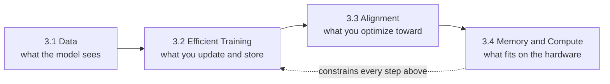
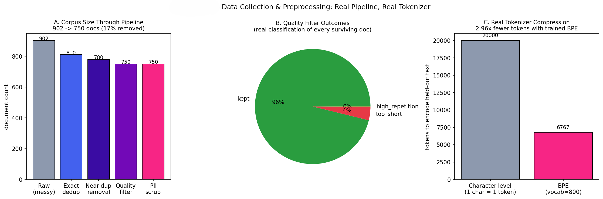
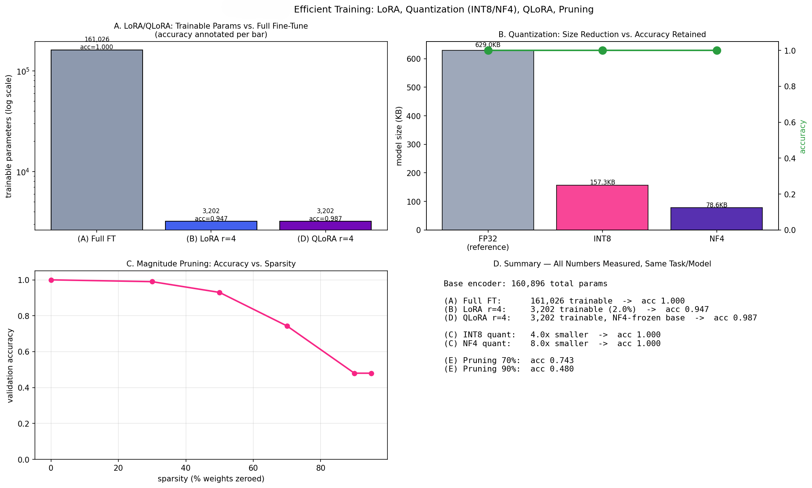
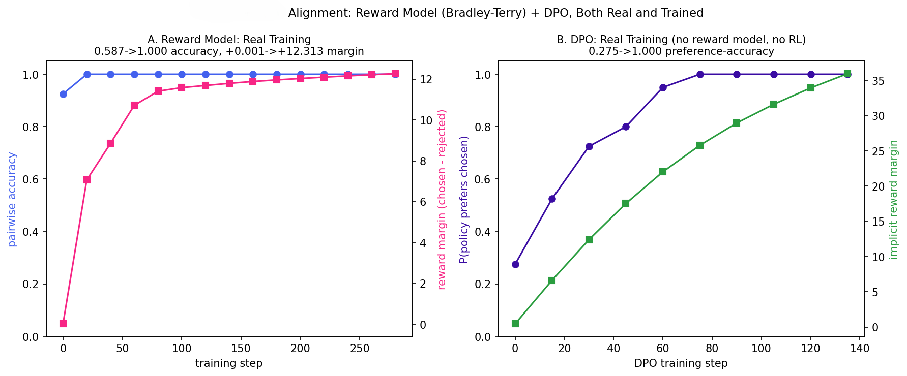

<div align="center">


*Phase 03 of [`llm-mastery`](../README.md) — a four-file (theory, code, explanation, Image), from-scratch LLM curriculum*

</div>

---

## Table of Contents

- [Overview](#overview)
- [The Arc of This Phase](#the-arc-of-this-phase)
- [Topics at a Glance](#topics-at-a-glance)
- [Folder Structure](#folder-structure)
- [Datasets and Models Used in This Phase](#datasets-and-models-used-in-this-phase)
- [Results Snapshot](#results-snapshot)
- [Highlights Gallery](#highlights-gallery)
- [Getting Started](#getting-started)
- [Known Issues](#known-issues)
- [Key References](#key-references)
- [Navigate](#navigate)
- [License](#license)
- [Author](#author)

---

## Overview

Phase 01 explained how a language model is built and why scale helps. Phase 02 took a pretrained checkpoint and asked which adaptation recipe to apply to it. Phase 03 asks what practitioners hit next: **how do you train and adapt a model when the data is dirty, memory is limited, and "good" means "preferred by people" rather than "low loss"?** Each topic attacks one bottleneck on that path: *what goes into training* (a real cleaning pipeline and a trained BPE tokenizer), *how much of the model you update and store* (LoRA, QLoRA, INT8/NF4 quantization, magnitude pruning), *what the model is optimized toward* (a Bradley-Terry reward model and DPO), and *what fits in memory* (gradient checkpointing and memory-conscious attention). The question the phase answers: **what does each efficiency or alignment technique actually buy, and what does it cost?**

This phase holds itself to the same standard as Phases 01 and 02: 4 of 4 topics were executed, and every number in this README comes from a committed result image or from the topic's own measured-results tables. All four ran on **CPU with small from-scratch models** (no GPU, no pretrained checkpoints), so the results demonstrate mechanisms and trade-off shapes, not production-scale quality. Two scope limits are stated up front: the PPO half of RLHF is **not** implemented (the reward model and DPO are), and the standalone FlashAttention kernel could not run without an Ampere-class GPU, so Topic 3.4 measures PyTorch's `scaled_dot_product_attention` as a related, honest substitute. Two outcomes are reported as measured rather than as the textbook story: QLoRA scored *higher* than LoRA (0.987 vs 0.947), which the theory doc attributes to single-seed variance, and DPO started at 0.275 rather than 0.5 because of a documented length bias in the metric. See [Results Snapshot](#results-snapshot) and [Known Issues](#known-issues).



## The Arc of This Phase

**3.1 — Data Collection and Preprocessing.** Why does what you filter out matter as much as what you train on? A corpus built from tiny-Shakespeare paragraphs is deliberately contaminated with exact duplicates, near-duplicates, boilerplate, low-quality strings, and fake PII at known rates, then pushed through a five-stage pipeline (exact dedup, near-duplicate removal by Jaccard over character 5-grams, heuristic quality filters, regex PII scrubbing, BPE tokenizer training). A trained 800-token BPE vocabulary encodes held-out text in 2.96× fewer tokens than character-level, and a real regex bug (a phone-number pattern that missed an entire template) was caught and fixed along the way → [result](#results-snapshot).

**3.2 — Efficient Training: LoRA, QLoRA, Quantization, Pruning.** How much of a model do you really need to train, store, or keep at full precision? Four techniques are applied to the *same* pretrained-then-fine-tuned encoder so the trade-offs are directly comparable: LoRA (rank 4, on the Q and V projections) trains about 2% of the parameters, QLoRA adds an NF4-quantized frozen base, INT8 and NF4 quantization shrink the stored weights, and magnitude pruning sweeps sparsity from 0% to 95%. Builds directly on the fine-tuning mechanics of Phase 02 → [result](#results-snapshot).

**3.3 — Alignment: RLHF and DPO.** How do you teach a model what people prefer when "preferred" is not a differentiable loss? A Bradley-Terry reward model and DPO are both trained for real on controlled preference pairs with a known quality signal, and the RL step of RLHF (PPO) is covered in equations only. The theory doc reports an honest confound: summed token log-probability favors shorter responses, so the pre-DPO policy "preferred" chosen answers only 27.5% of the time before any training → [result](#results-snapshot).

**3.4 — Memory and Computational Challenges.** Where does memory go during training, and what is the cheapest way to get it back? Gradient checkpointing on a 24-layer Transformer cuts peak memory by 35.0% for an 18.5% time overhead, each condition measured in a fresh subprocess because peak-RSS only ever rises. A naive attention implementation that materializes the full `T × T` matrix is then compared against PyTorch's SDPA across sequence lengths, tying back to the quadratic-attention analysis in Phase 01 → [result](#results-snapshot).

## Topics at a Glance

| # | Topic | Folder | What the code actually proves |
|---|-------|--------|--------------------------------|
| 1 | Data Collection and Preprocessing for LLMs | [`01-Data_Collection_and_Preprocessing`](01-Data_Collection_and_Preprocessing) | A five-stage pipeline takes 902 contaminated documents to 750, and a trained BPE tokenizer compresses held-out text 2.96× versus character-level |
| 2 | Efficient Training: LoRA, QLoRA, Quantization, Pruning | [`02-Efficient_Training`](02-Efficient_Training) | LoRA trains 3,202 of 161,026 parameters for 0.947 accuracy (full FT: 1.000); INT8 and NF4 keep 1.000 accuracy; pruning collapses to chance by 90% sparsity |
| 3 | Alignment Methodologies: RLHF and DPO | [`03-Alignment`](03-Alignment) | A reward model (0.587 to 1.000 pairwise accuracy) and DPO (0.275 to 1.000 preference accuracy) both train cleanly on controlled preference pairs; PPO is not implemented |
| 4 | Memory and Computational Challenges | [`04-Memory_and_Computational_Challenges`](04-Memory_and_Computational_Challenges) | Gradient checkpointing saves 35.0% peak memory at an 18.5% time cost; SDPA beats naive attention by 2.4× in memory and 5.5× in time at T=1024 (CPU) |

Every topic follows the repository's four-file structure: `README.md` (theory), `implementation.py`, `explanation.md`, and a result image under `Image/`. See [Known Issues](#known-issues) for stale cross-references and caveats.

## Folder Structure

```
03-Training_and_Optimization/
├── README.md                                           (this file)
│
├── 01-Data_Collection_and_Preprocessing/
│   ├── README.md              — theory: dedup (exact and near), MinHash/LSH at scale, quality filters, PII limits, BPE
│   ├── implementation.py      — contaminates a corpus, runs the five-stage pipeline, trains an 800-token BPE tokenizer
│   ├── explanation.md         — walkthrough: hashing, n-gram Jaccard, the phone-regex fix, tokenizer training
│   └── Image/
│       └── Data_Collection.png
│
├── 02-Efficient_Training/
│   ├── README.md              — theory: LoRA, INT8 vs NF4, QLoRA, magnitude pruning
│   ├── implementation.py      — LoRALinear, QLoRALinear, INT8/NF4 quantizers, kthvalue pruning on one shared encoder
│   ├── explanation.md         — walkthrough: frozen-base wrapping, deep-copy quantization, index storage, broadcasting
│   └── Image/
│       └── Efficient_Training.png
│
├── 03-Alignment/
│   ├── README.md              — theory: Bradley-Terry reward model, DPO derivation, why PPO is scoped out
│   ├── implementation.py      — reward model, frozen-reference DPO, controlled length-balanced preference data
│   ├── explanation.md         — walkthrough: template balancing, sequence_logprob, response masking
│   └── Image/
│       └── Alignment.png
│
└── 04-Memory_and_Computational_Challenges/
    ├── README.md              — theory: activation vs attention memory, checkpointing, why FlashAttention cannot run here
    ├── implementation.py      — subprocess-isolated peak-memory and timing measurements, naive vs SDPA sweep
    ├── explanation.md         — walkthrough: ru_maxrss high-water mark, isolation, benchmark design
    └── Image/
        └── Memory_&_Computational_Challenges.png
```

## Datasets and Models Used in This Phase

| Topic | Data / model | Notes |
|-------|--------------|-------|
| 3.1 | Paragraphs from tiny-Shakespeare, downloaded at startup, plus injected noise: 40 exact duplicates, 40 near-duplicates, 30 boilerplate, 30 low-quality strings, 20 fake-PII documents (902 documents in total). Tokenizer: Hugging Face `tokenizers` BPE, vocabulary 800, evaluated on a held-out 20,000-character slice | CPU only, no model download. Near-duplicates use Jaccard over character 5-grams at threshold 0.8 (exact, `O(n²)`); quality filters: length under 20, alpha ratio under 0.6, unique-word ratio under 0.4 |
| 3.2 | Pretraining: 500 MLM steps on tiny-Shakespeare. Task: 1,200 synthetic movie-review sentences (900 train / 300 validation), 8 positive and 8 negative adjectives. Model: character-level encoder, 3 layers, `d_model` 64, 4 heads, 160,896 base parameters | Each method fine-tunes for 250 steps. LoRA rank 4, alpha 8, on Q and V projections; NF4 levels from standard-normal quantile midpoints |
| 3.3 | 400 synthetic preference pairs (320 train / 80 validation); chosen answers are polite and helpful, rejected are curt, lengths balanced on purpose. Reward model: bidirectional 2-layer encoder, `d_model` 64, scalar head, 300 steps. Policy: 2-layer causal model, 500 pretraining steps, frozen reference copy, DPO `β` = 0.1 for 150 steps | DPO accuracy is measured on the first 40 validation pairs. Corpus is downloaded at startup |
| 3.4 | Synthetic batches. Checkpointing test: 24-layer Transformer (about 4.8M parameters), `d_model` 128, 8 heads, sequence length 256, batch 16, 5 forward-plus-backward passes. Attention sweep: naive vs SDPA at sequence lengths 128, 256, 512, 1,024 | Each condition runs in its own subprocess; memory is peak resident set size (`ru_maxrss`) and includes a fixed interpreter and PyTorch baseline of roughly 520 MB. No network needed |

## Results Snapshot

Numbers below come from each topic's committed result image or its own measured-results table. All are single-run, single-seed measurements on small CPU-trained models:

| Topic | Headline result |
|-------|------------------|
| 3.1 — Data pipeline | Document count: raw **902**, after exact dedup **810**, after near-duplicate removal **780**, after quality filter **750**, after PII scrub **750** (17% removed overall; PII scrubbing rewrites documents rather than dropping them). The quality filter rejected 4% of survivors as too short and about 0% for repetition. Character-level encoding of held-out text takes **20,000** tokens; the 800-token BPE tokenizer takes **6,767**, a **2.96×** compression, which the theory doc translates to roughly 9× less attention compute because attention cost is quadratic in length |
| 3.2 — Efficient training | Full fine-tuning: **161,026** trainable parameters, accuracy **1.000**. LoRA r=4: **3,202** trainable (2.0%), accuracy **0.947**. QLoRA r=4: **3,202** trainable on an NF4-frozen base, accuracy **0.987**. INT8: **4.0×** smaller (157.3 KB vs 629.0 KB), accuracy **1.000**. NF4: **8.0×** smaller (78.6 KB), accuracy **1.000**, weight RMSE 0.01077 vs INT8's 0.00089. Magnitude pruning accuracy at 0 / 30 / 50 / 70 / 90 / 95% sparsity: **1.000 / 0.990 / 0.930 / 0.743 / 0.480 / 0.480**, i.e. chance on this binary task from 90% on |
| 3.3 — Alignment | Reward model: pairwise accuracy **0.587 to 1.000**, mean reward margin **+0.001 to +12.313**. DPO: P(policy prefers chosen) **0.275 to 1.000**, implicit reward margin **+0.000 to +37.668**, growing monotonically with no instability at any logged checkpoint. The 0.275 start (not 0.5) is a real length bias in summed log-probability, reduced but not eliminated by balancing template lengths to 38 vs 34.75 characters |
| 3.4 — Memory and compute | Gradient checkpointing, 24-layer model: peak memory **1,630 MB to 1,060 MB** (**35.0%** reduction), time for 5 passes **10.6 s to 12.6 s** (**18.5%** overhead). Naive vs SDPA attention at T = 128 / 256 / 512 / 1,024: memory **524.5 / 586.6 / 709.2 / 1,299.4 MB** vs **520.1 / 520.1 / 525.6 / 545.7 MB**; time **9.3 / 32.6 / 228.8 / 1,126.6 ms** vs **5.2 / 15.9 / 56.1 / 206.4 ms**. At T=1,024 naive uses about 2.4× the memory and 5.5× the time |

## Highlights Gallery

<div align="center">

<table>
<tr>
<td width="50%"><br/><sub><b>3.1</b> — 902 to 750 documents through the pipeline; BPE encodes held-out text in 2.96× fewer tokens</sub></td>
<td width="50%"><br/><sub><b>3.2</b> — 50× fewer trainable parameters with LoRA; INT8 and NF4 lose no accuracy here; pruning collapses past 70%</sub></td>
</tr>
<tr>
<td width="50%"><br/><sub><b>3.3</b> — reward model and DPO both reach 1.000 preference accuracy on controlled pairs</sub></td>
<td width="50%"><br/><sub><b>3.4</b> — checkpointing trades 35.0% memory for 18.5% time; SDPA stays flat in memory as sequences grow</sub></td>
</tr>
</table>

</div>

> Spaces in image filenames must be URL-encoded (`%20`) in `src`. The Topic 3.4 filename contains `&`, which is written as `%26` above.

## Getting Started

Repo-wide setup, from the repository root:

```bash
git clone https://github.com/Ayush-2703/Large_languaage_Models.git
cd Large_languaage_Models

python -m venv venv
source venv/bin/activate          # Windows: venv\Scripts\activate

pip install -r requirements.txt
cd 03-Training_and_Optimization
```

Each topic's `implementation.py` is self-contained and runs standalone on CPU, since the models are tiny. Topics 3.1 to 3.3 download the tiny-Shakespeare corpus at startup, so they need an internet connection; Topic 3.4 needs none:

```bash
cd 01-Data_Collection_and_Preprocessing && python implementation.py && cd ..        # local, CPU is fine
cd 02-Efficient_Training && python implementation.py && cd ..                       # local, CPU is fine
cd 03-Alignment && python implementation.py && cd ..                                # local, CPU is fine
cd 04-Memory_and_Computational_Challenges && python implementation.py && cd ..      # local, CPU is fine
```

Topic 3.2 imports `scipy.stats` (for the NF4 quantile levels) and Topic 3.1 imports `tokenizers`; both come in through `requirements.txt` (SciPy transitively via scikit-learn). Topics 3.2 to 3.4 select a CUDA device automatically if one is present, but every number in this README was produced on CPU. Topic 3.4 launches child Python processes, so run it from a normal shell rather than an interactive session that restricts subprocesses.

## Known Issues

Found while documenting this phase, for anyone relying on it:

- **Everything ran on CPU with toy models, not on a Colab T4 with pretrained checkpoints.** The repository root README describes a free-tier T4 and small pretrained checkpoints (DistilBERT, GPT-2, and so on), but none of Phase 03 uses a pretrained model or a GPU. `peft`, `bitsandbytes`, and `trl` are listed in `requirements.txt` for this phase but no Phase 03 script imports them; LoRA, NF4, and DPO are all implemented from scratch.
- **PPO is not implemented.** Topic 3.3 trains a real reward model and real DPO, but the policy-optimization half of RLHF (rollouts, value function, clipped objective) is described in `README.md` only, as a deliberate scoping decision.
- **FlashAttention was not run.** The fused kernel needs an Ampere-class GPU or newer, and there was no GPU. Topic 3.4's naive-versus-SDPA comparison shows the general cost of materializing the `T × T` matrix on CPU; it does not reproduce FlashAttention's SRAM/HBM tiling, and the theory doc says so.
- **Topic 3.2 sizes are idealized and quantization is simulated.** Model size is computed as parameter count × bits ÷ 8 over *all* parameters (including embeddings, biases, and LayerNorm), though only `nn.Linear` weights are actually quantized, so the 4.0× and 8.0× figures are upper bounds. In the standalone INT8 and NF4 comparison, weights are rounded to the quantization grid and kept as float32 for evaluation. The NF4 levels are symmetric quantile midpoints (not the original paper's construction with an exact zero level), and scaling is per tensor rather than per block of 64 weights.
- **QLoRA beating LoRA (0.987 vs 0.947) is not a finding.** Both adapters start from independent random `lora_A` draws and each number is one seed, so the gap is within expected run-to-run variance. The defensible conclusion is that QLoRA is comparable to LoRA, not better.
- **Topic 3.3 has a measurement confound and a small evaluation set.** Summed token log-probability favors shorter responses, which is why the pre-DPO policy prefers chosen answers only 27.5% of the time; balancing template lengths reduced this but did not remove it. DPO preference accuracy is measured on 40 validation pairs, and the controlled templates are far easier than real preference data, so 1.000 should not be read as a general alignment result.
- **Topic 3.3's reward-model panel title and curve start at different values.** The title reports 0.587 as the starting accuracy (the pre-training evaluation), but the first plotted point sits near 0.92 because the history appears to be logged after the first optimizer step.
- **Topic 3.4's memory figures are whole-process peaks.** `ru_maxrss` includes roughly 520 MB of fixed interpreter and PyTorch overhead, so the 35.0% is a reduction in total process peak, not in activation memory alone. Timings are wall-clock on a shared CPU with no repeats.
- **Topic 3.1's script header says MinHash, but the code computes exact Jaccard.** The `implementation.py` docstring describes "MinHash-approximated Jaccard", while the function compares every pair exactly (`O(n²)`), as the theory doc states correctly. The PII regexes also cover only the script's own synthetic email and phone formats.
- **Theory and explanation docs use outdated names.** They reference `theory.md`, `proof.png`, and paths such as `01-Review-of-Fundamental-LLMs/...`. The actual files are `README.md` and descriptively named images, and folders use underscores. The content is right; the cross-references are stale.
- **The repository root README's Phase 03 links 404 and its topic names differ.** They point to a hyphenated `03-Training-and-Optimization-of-LLMs/...` scheme, and list Topic 3 as `03-Alignment-RLHF-and-DPO` while the folder is `03-Alignment`. The links in this README are all relative and correct.
- **Every result is single-seed, and Topic 3.4's image has crowded labels.** Nothing here is averaged over random seeds. In Topic 3.1's panel B the "0%" and "4%" pie labels overlap their category names.

## Key References

**Core texts** (paraphrased throughout this phase's theory docs, cited by title and author, never block-quoted)

1. Rothman, Denis. *Transformers for Natural Language Processing.*
2. Tunstall, Lewis, Leandro von Werra, and Thomas Wolf. *Natural Language Processing with Transformers.*

**Topic 3.1 — Data Collection and Preprocessing**

3. Sennrich, Rico, Barry Haddow, and Alexandra Birch. "Neural Machine Translation of Rare Words with Subword Units." *ACL*, 2016.
4. Raffel, Colin, et al. "Exploring the Limits of Transfer Learning with a Unified Text-to-Text Transformer." *JMLR*, 2020.
5. Rae, Jack W., et al. "Scaling Language Models: Methods, Analysis & Insights from Training Gopher." 2021.
6. Lee, Katherine, et al. "Deduplicating Training Data Makes Language Models Better." *ACL*, 2022.

**Topic 3.2 — Efficient Training**

7. Hu, Edward J., et al. "LoRA: Low-Rank Adaptation of Large Language Models." *ICLR*, 2022.
8. Dettmers, Tim, et al. "QLoRA: Efficient Finetuning of Quantized LLMs." *NeurIPS*, 2023.
9. Han, Song, Huizi Mao, and William J. Dally. "Deep Compression: Compressing Deep Neural Networks with Pruning, Trained Quantization and Huffman Coding." *ICLR*, 2016.

**Topic 3.3 — Alignment**

10. Christiano, Paul F., et al. "Deep Reinforcement Learning from Human Preferences." *NeurIPS*, 2017.
11. Schulman, John, et al. "Proximal Policy Optimization Algorithms." 2017.
12. Ouyang, Long, et al. "Training Language Models to Follow Instructions with Human Feedback." *NeurIPS*, 2022.
13. Rafailov, Rafael, et al. "Direct Preference Optimization: Your Language Model is Secretly a Reward Model." *NeurIPS*, 2023.

**Topic 3.4 — Memory and Computational Challenges**

14. Chen, Tianqi, et al. "Training Deep Nets with Sublinear Memory Cost." 2016.
15. Dao, Tri, et al. "FlashAttention: Fast and Memory-Efficient Exact Attention with IO-Awareness." *NeurIPS*, 2022.

## Navigate

⬅ [Phase 02 — Generative AI with LLMs](../02-Generative_AI_with_LLMs) · [Repository root](../README.md) · ➡ [Phase 04 — Applications and Use Cases](../04-Applications_and_Use_Cases)

---

<div align="center">


</div>
