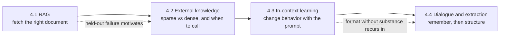
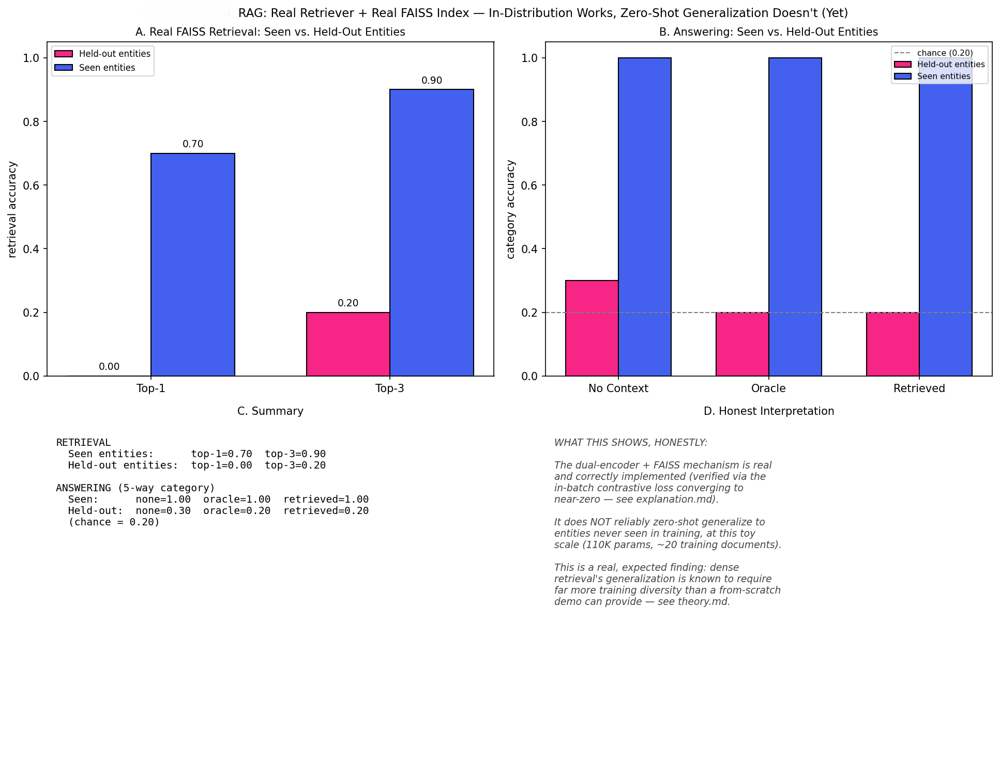
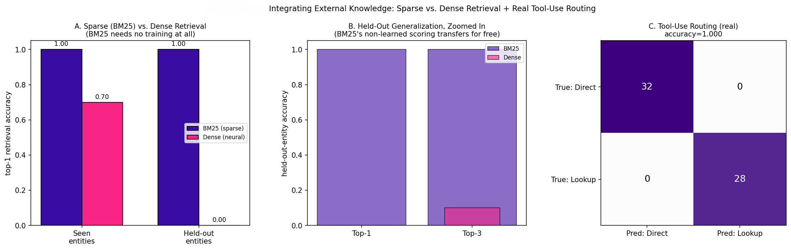
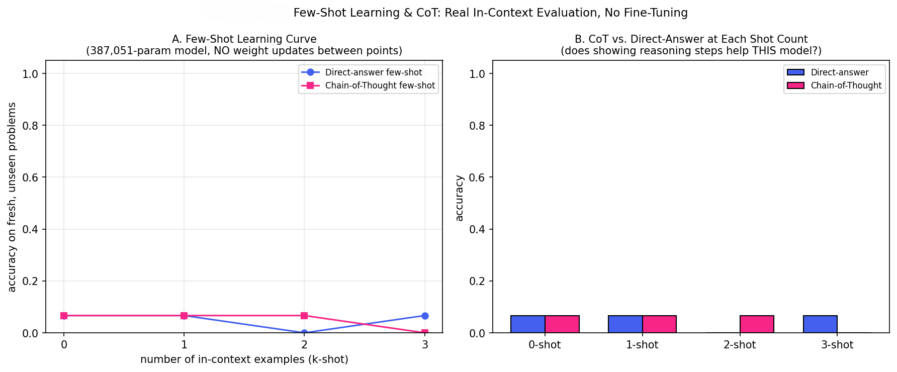
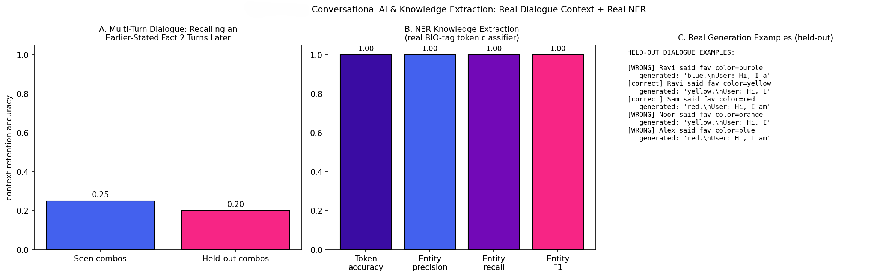

<div align="center">


*Phase 04 of [`Large_languaage_Models`](../README.md) — a four-file (theory, code, explanation, Image), from-scratch LLM curriculum*

</div>

---
 
## Table of Contents

- [Overview](#overview)
- [The Arc of This Phase](#the-arc-of-this-phase)
- [Topics at a Glance](#topics-at-a-glance)
- [Folder Structure](#folder-structure)
- [Datasets and Models Used in This Phase](#datasets-and-models-used-in-this-phase)
- [Results Snapshot](#results-snapshot)
- [Highlights Gallery](#highlights-gallery)
- [Getting Started](#getting-started)
- [Known Issues](#known-issues)
- [Key References](#key-references)
- [Navigate](#navigate)
- [License](#license)
- [Author](#author)

---

## Overview

Phases 01 to 03 explained how a language model is built, adapted, and trained. Phase 04 asks how that machinery is actually *used*: how a model answers questions about facts that were never in its weights (retrieval), how it decides when to look something up at all (tool use), how a prompt alone can change its behavior with no gradient step (few-shot and chain-of-thought), and how it carries information across the turns of a conversation (dialogue and extraction). **The question the phase answers: which application techniques hold up when you measure them on held-out data, and which only look good on the data they were fit to?**

This phase holds itself to the same standard as Phases 01 to 03: 4 of 4 topics were executed, and every number in this README is copied from a topic's own measured-results tables. All four run on **CPU with small from-scratch models** (no GPU, no API key, no pretrained checkpoint), so the results show mechanisms and failure shapes, not production-scale quality. Three of the four topics report a negative or modest result on held-out data, and those results are kept in rather than tuned away.



## The Arc of This Phase

**4.1 — Introduction to RAG with Vector DBs.** The question is whether a small trained retriever plus a real FAISS index can ground an answering model in facts it has never seen. A dual encoder is trained with in-batch-negative contrastive loss over an invented knowledge base, indexed with `IndexFlatIP`, and evaluated on seen and fully held-out entities → [result](#results-snapshot).

**4.2 — Integrating External Knowledge into LLMs.** Topic 4.1's held-out failure raises two follow-ups: is there a retriever that needs no training, and can a model learn *when* to retrieve? A from-scratch BM25 is compared head to head with the dense retriever, and a small classifier learns to route queries to lookup or direct answer → [result](#results-snapshot).

**4.3 — Chain-of-Thought Prompting and Few-Shot Learning.** With weights frozen, does showing 0 to 3 worked examples, with or without reasoning steps, change accuracy? The expectation (CoT is scale-emergent, so it should not help a model this small) is written into the script before any run, and the generated text is inspected to see *why* accuracy stays low → [result](#results-snapshot). This sets up the emergence question in `05-Frontiers_and_Future_of_LLMs/01-Emergent_Behaviors_and_Scaling_Hypotheses`.

**4.4 — Conversational AI, Chatbots, and Knowledge Extraction.** Two separate capabilities behind a chatbot are measured: retaining a stated value across an irrelevant intervening turn (causal decoder), and tagging people, organizations, and locations in text (bidirectional encoder, BIO scheme). The dialogue experiment includes a real evaluation-split bug that was found and fixed → [result](#results-snapshot).

## Topics at a Glance

| # | Topic | Folder | What the code actually proves |
|---|-------|--------|--------------------------------|
| 4.1 | Introduction to RAG with Vector DBs | [`01-RAG_Vector_DBs`](01-RAG_Vector_DBs) | Contrastive dense retrieval plus FAISS works on seen entities (top-3 = 0.900) and does not transfer to unseen ones at this scale (top-3 = 0.200) |
| 4.2 | Integrating External Knowledge into LLMs | [`02-Integrating_External_Knowledge`](02-Integrating_External_Knowledge) | Untrained BM25 reaches 1.000 held-out top-1 where the trained dense retriever reaches 0.000, and a routing classifier separates lookup from direct queries perfectly on a lexically easy task |
| 4.3 | Chain-of-Thought Prompting and Few-Shot Learning | [`03-Chain_of_Thought_Prompting_and_Few_Shot_Learning`](03-Chain_of_Thought_Prompting_and_Few_Shot_Learning) | A 387,051-parameter decoder shows no clear benefit from extra shots or CoT, and its reasoning text is format without correct arithmetic |
| 4.4 | Conversational AI, Chatbots, and Knowledge Extraction | [`04-AI_Chatbots_Knowledge_Extraction`](04-AI_Chatbots_Knowledge_Extraction) | Cross-turn recall is modestly above chance (0.250 seen, 0.200 held-out vs 0.167), while BIO-tag NER on templated text is solved (F1 = 1.000) |

Every topic follows the repository's four-file structure: `README.md` (theory), `implementation.py`, `explanation.md`, and a result image under `Image/`. See [Known Issues](#known-issues) for the image naming caveat.

## Folder Structure

```
04-Applications_and_Use_Cases/
├── README.md                                   (this file)
│
├── 01-RAG_Vector_DBs/
│   ├── README.md              — theory: dual-encoder retrieval, InfoNCE, FAISS, why held-out retrieval fails
│   ├── implementation.py      — invented knowledge base, dual encoder, FAISS index, answerer under 3 context conditions
│   ├── explanation.md         — walkthrough, including the multi-stage debugging history
│   └── Image/
│       └── RAG.png
│
├── 02-Integrating_External_Knowledge/
│   ├── README.md              — theory: BM25 formula, sparse vs dense trade-off, tool-use routing
│   ├── implementation.py      — BM25 class, dense retriever, ToolClassifier
│   ├── explanation.md
│   └── Image/
│       └── Integrating_External_Knowledge.png
│
├── 03-Chain_of_Thought_Prompting_and_Few_Shot_Learning/
│   ├── README.md              — theory: in-context learning, CoT, emergence caveat, unfaithful reasoning
│   ├── implementation.py      — frozen decoder, 0 to 3-shot, direct vs CoT prompts
│   ├── explanation.md         — includes the answer-extraction bug and its fix
│   └── Image/
│       └── Few-Shot_Learning.png
│
└── 04-AI_Chatbots_Knowledge_Extraction/
    ├── README.md              — theory: multi-turn context, associative recall, BIO tagging
    ├── implementation.py      — DialogueGPT and NERTagger
    ├── explanation.md         — includes the train/eval split bug and its fix
    └── Image/
        └── Conversational_Al.png
```

## Datasets and Models Used in This Phase

| Topic | Data / model | Notes |
|-------|--------------|-------|
| 4.1 | Invented fact base (5 shared categories, many-to-one) plus real tiny-Shakespeare distractor chunks, 230 documents in the index · dual-encoder retriever, 110,528 parameters (`D_MODEL=64`, 4 heads, 2 layers) · FAISS `IndexFlatIP` | CPU, about a minute per the script docstring. Corpus fetched at run time over HTTPS |
| 4.2 | Same invented-fact design, 20 training documents · BM25 (no parameters) · same dense retriever configuration · binary `ToolClassifier` | CPU, about a minute per the script docstring. Retrains its own retriever rather than loading a checkpoint |
| 4.3 | tiny-Shakespeare pretraining plus 1,500 worked arithmetic examples · decoder, 387,051 parameters (`D_MODEL=96`, 6 heads, 3 layers) | CPU, a couple of minutes per the script docstring. 15 trials per condition |
| 4.4 | 400 synthetic training dialogues drawn from 268 eligible name/color/job combinations, 1,000 pretraining steps · `DialogueGPT` (causal) · `NERTagger` (bidirectional, 3 entity types) | CPU, a couple of minutes per the script docstring |

## Results Snapshot

| Topic | Headline result |
|-------|------------------|
| 4.1 | **Seen entities: retrieval top-1 / top-3 = 0.700 / 0.900, answering = 1.000.** **Held-out entities: retrieval top-1 / top-3 = 0.000 / 0.200**, and answering with no context, oracle context, and FAISS-retrieved context = 0.300 / 0.200 / 0.200 against a 0.200 chance level (5-way). The mechanism works in-distribution; zero-shot transfer to new entities does not appear at this scale, and two rounds of improvement (more facts, larger contrastive batches) did not change that. |
| 4.2 | **BM25 held-out top-1 = 1.000 vs dense held-out top-1 = 0.000** (seen: 1.000 vs 0.700). BM25's score is structural, since it has no train/test split and every query shares distinctive vocabulary with its document, so it is not evidence of better retrieval in general. **Tool routing accuracy = 1.000**, with zero false positives and zero false negatives, on two lexically distinct query types. |
| 4.3 | **Accuracy stays between 0.000 and 0.067 across all eight conditions** (0 to 3 shots, direct and CoT), with 15 trials each, so no trend is distinguishable from noise. Generated "reasoning" copies the format but not the problem's numbers (for example `8+1=10, 10-1=7`), consistent with Wei et al.'s finding that CoT gains appear only at larger scale. |
| 4.4 | **Dialogue recall: 0.250 seen, 0.200 held-out, chance = 0.167** after the split bug was fixed and pretraining was raised from 500 to 1,000 steps (loss 0.889 to 0.630). **NER: token accuracy = 1.000, entity-level P/R/F1 = 1.000** on a templated vocabulary, so this is an easy case and should not be read as a general NER result. |

All figures come from each topic's committed tables and prose. They were not re-executed when this README was written (see [Known Issues](#known-issues)).

## Highlights Gallery

<div align="center">

<table>
<tr>
<td width="50%"><br/><sub><b>4.1</b> — retrieval and answering, seen vs held-out entities</sub></td>
<td width="50%"><br/><sub><b>4.2</b> — BM25 vs dense retrieval, seen and held-out</sub></td>
</tr>
<tr>
<td width="50%"><br/><sub><b>4.3</b> — few-shot curve, direct vs chain-of-thought</sub></td>
<td width="50%"><br/><sub><b>4.4</b> — dialogue context recall and NER</sub></td>
</tr>
</table>

</div>

## Getting Started

Repo-wide setup, from the repository root:

```bash
git clone https://github.com/Ayush-2703/Large_languaage_Models.git
cd Large_languaage_Models

python -m venv venv
source venv/bin/activate          # Windows: venv\Scripts\activate

pip install -r requirements.txt
cd 04-Applications_and_Use_Cases
```

Phase 04 scripts import only `torch`, `numpy`, `matplotlib`, and (topics 4.1 and 4.2) `faiss-cpu`. Each `implementation.py` is self-contained and runs standalone on CPU, with no API key and no Hugging Face Hub access:

```bash
cd 01-RAG_Vector_DBs                              && python implementation.py && cd ..   # about a minute
cd 02-Integrating_External_Knowledge              && python implementation.py && cd ..   # about a minute
cd 03-Chain_of_Thought_Prompting_and_Few_Shot_Learning && python implementation.py && cd ..   # a couple of minutes
cd 04-AI_Chatbots_Knowledge_Extraction            && python implementation.py && cd ..   # a couple of minutes
```

Each script downloads the tiny-Shakespeare text at run time (15-second timeout), so the first run needs internet access. A GPU is used automatically if present but is not required.

## Known Issues

- **Result images are saved as `proof.png`, then renamed.** All four scripts call `plt.savefig("proof.png")` in the working directory, while the committed images live under each topic's `Image/` with descriptive names (`RAG.png`, `Few-Shot_Learning.png`, and so on). After re-running, copy the new image over the committed one by hand, or change the `savefig` path.
- **No machine-readable results for Phase 04.** Phase 05 topics ship a `results.json` beside the image; Phase 04 topics keep their numbers only in the images and the README and `explanation.md` tables. Adding a `json.dump` of the final metrics to each script would close that gap.
- **Held-out retrieval is near zero in 4.1 and 4.2 (dense).** This is an expected small-data limitation (110,528 parameters, 20 to 30 training documents), investigated in 4.1 rather than left as an unexplained failure, but it means the dense retriever in this phase demonstrates the mechanism, not generalization.
- **4.3 has 15 trials per condition.** A true 10% accuracy can show as 0 to 3 successes by chance, so individual cells should not be compared. The conclusion that nothing clearly helps is robust; the specific decimals are not.
- **4.4's NER result is a ceiling effect.** Templated text with a small vocabulary is trivially separable, so F1 = 1.000 says the pipeline is correct, not that the model handles real-world entity ambiguity.
- **`requirements.txt` is repo-wide.** It lists packages (`sentence-transformers`, `gradio`, `trl`, and others) that no Phase 04 script imports.
- **Root README links for Phase 04 point to folder names that do not exist** (for example `04-Applications-and-Use-Cases/01-Retrieval-Augmented-Generation-RAG-Vector-DBs/`), and it refers to per-topic `STATUS.md` files that are not present in this phase. Fix these in the root README. Cross-references inside this phase's topic docs were updated to the real folder names.

## Key References

**Core texts** (paraphrased throughout this phase's theory docs, cited by title and author, never block-quoted)

1. Rothman, Denis. *Transformers for Natural Language Processing.*
2. Tunstall, Lewis, Leandro von Werra, and Thomas Wolf. *Natural Language Processing with Transformers.*

**Topic 4.1 — RAG and dense retrieval**

3. Lewis, Patrick, et al. "Retrieval-Augmented Generation for Knowledge-Intensive NLP Tasks." *NeurIPS*, 2020.
4. Karpukhin, Vladimir, et al. "Dense Passage Retrieval for Open-Domain Question Answering." *EMNLP*, 2020.

**Topic 4.2 — Sparse retrieval and tool use**

5. Robertson, Stephen, and Hugo Zaragoza. "The Probabilistic Relevance Framework: BM25 and Beyond." *Foundations and Trends in Information Retrieval*, 2009.
6. Schick, Timo, et al. "Toolformer: Language Models Can Teach Themselves to Use Tools." 2023.

**Topic 4.3 — In-context learning and chain of thought**

7. Brown, Tom, et al. "Language Models are Few-Shot Learners." *NeurIPS*, 2020.
8. Wei, Jason, et al. "Chain-of-Thought Prompting Elicits Reasoning in Large Language Models." *NeurIPS*, 2022.
9. Wei, Jason, et al. "Emergent Abilities of Large Language Models." *TMLR*, 2022.

**Topic 4.4 — Dialogue and extraction**

10. Sang, Erik F., and Fien De Meulder. "Introduction to the CoNLL-2003 Shared Task: Language-Independent Named Entity Recognition." *CoNLL*, 2003.
11. Olsson, Catherine, et al. "In-context Learning and Induction Heads." Anthropic, 2022.

## Navigate

⬅ [Phase 03 — Training and Optimization](../03-Training_and_Optimization) · [Repository root](../README.md) · ➡ [Phase 05 — Frontiers and Future of LLMs](../05-Frontiers_and_Future_of_LLMs)

---

<div align="center">


</div>
