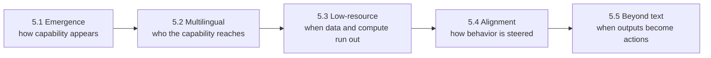
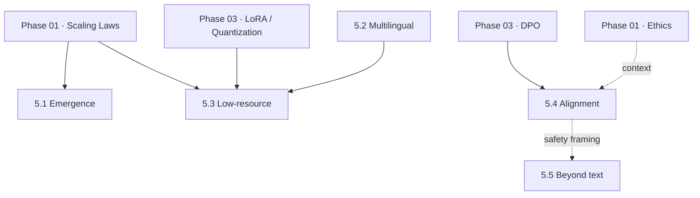

<div align="center">


*Phase 05 of [`Large_languaage_Models`](../README.md) — a four-file (theory, code, explanation, proof), Colab-first LLM curriculum*

</div>

---

> **Status: specification, not results.** The five topic folders and this module README exist. Every topic's theory `README.md`, `implementation.py`, `explanation.md` and result image are still to be written and executed. This document is the **experimental charter** for the phase: the questions, the pre-stated hypotheses, the designs, the metrics, and the conditions under which each hypothesis would be counted as wrong. It does not claim results, measured runtimes, or images that do not exist. Every number-shaped cell below reads `not yet run`, and stays that way until `implementation.py` produces it.

---

## Table of Contents

- [Overview](#overview)
- [Phase Thesis](#phase-thesis)
- [How This Phase Differs from Phases 01–04](#how-this-phase-differs-from-phases-0104)
- [Topics at a Glance](#topics-at-a-glance)
- [Evidence Policy](#evidence-policy)
- [Shared Experimental Protocol](#shared-experimental-protocol)
- [Topic Specifications](#topic-specifications)
  - [5.1 Emergent Behaviors and Scaling Hypotheses](#51-emergent-behaviors-and-scaling-hypotheses)
  - [5.2 Multilingual and Cross-lingual Capabilities](#52-multilingual-and-cross-lingual-capabilities)
  - [5.3 LLMs in Low-Resource Settings](#53-llms-in-low-resource-settings)
  - [5.4 Alignment and Controllability of LLMs](#54-alignment-and-controllability-of-llms)
  - [5.5 Beyond Text: Robotics, Vision-Language Models, and Decision-Making](#55-beyond-text-robotics-vision-language-models-and-decision-making)
- [Cross-Topic Dependencies](#cross-topic-dependencies)
- [Planned Folder Structure](#planned-folder-structure)
- [Compute Budget](#compute-budget)
- [Results Ledger](#results-ledger)
- [Definition of Done](#definition-of-done)
- [Build Progress](#build-progress)
- [Getting Started](#getting-started)
- [Known Issues](#known-issues)
- [Key References](#key-references)
- [Navigate](#navigate)

---

## Overview

Phases 01 through 04 are about understanding, adapting, training, and deploying the language models that exist today. Phase 05 asks where the edges of that picture are.

- Why do some abilities seem to appear suddenly as models grow, and is "suddenly" a property of the model or of how we measure it?
- What happens to a system trained mostly on English when it meets a hundred other languages, or a language with almost no training data?
- How reliably can behavior be steered once a model is capable enough that steering matters, and where does steering fail?
- What changes when the input is no longer only text: images, robot sensors, or a decision that must be acted on?

This is the least settled part of the curriculum, and the treatment reflects that. Where the field has open disagreements (emergence is the clearest case), the plan is to present the competing explanations, state in advance what each one predicts, and test what a small, honestly measured experiment can and cannot say. The goal is calibrated claims, not a chosen side.

## Phase Thesis

> Frontier questions are best studied at small scale by turning each into a **falsifiable prediction** and a **measurement that could embarrass the hypothesis**.

Each topic therefore commits to three things *before* any code runs: a research question, hypotheses with explicit falsifiers, and the exact metrics that will be reported. If a result contradicts the hypothesis, or is inconclusive, it is reported as such.



## How This Phase Differs from Phases 01–04

| Dimension | Phases 01–04 | Phase 05 |
| --- | --- | --- |
| Nature of the question | Established technique, correct answer exists | Open or contested, no consensus answer |
| What the code demonstrates | "The method works as described" | "Here is what a small experiment can and cannot say" |
| Role of the hypothesis | Implicit | Stated up front, with a falsifier |
| Acceptable outcomes | Working result | Working result, negative result, or inconclusive result, all reported |
| Scale gap | Small run approximates the real method | Small run is a **probe**; the production-scale picture is covered conceptually and labeled as such |
| Main risk | Bugs | Over-claiming from a small experiment |

## Topics at a Glance

| # | Topic | Folder | Core question | Method family | Primary proposed models (unselected until validated) |
|---|-------|--------|---------------|---------------|------------------------------------------------------|
| 5.1 | Emergent Behaviors and Scaling Hypotheses | [`01-Emergent_Behaviors_and_Scaling_Hypotheses`](./01-Emergent_Behaviors_and_Scaling_Hypotheses) | Is emergence a property of models or of discontinuous metrics? | Metric re-analysis across a model-size ladder | Pythia 70M–1.4B |
| 5.2 | Multilingual and Cross-lingual Capabilities | [`02-lingual_Capabilities`](./02-lingual_Capabilities) | What transfers across languages, what does not, and why? | Zero-shot cross-lingual transfer plus tokenizer analysis | XLM-R base, mBERT |
| 5.3 | LLMs in Low-Resource Settings | [`03-Low_Resource_Settings`](./03-Low_Resource_Settings) | What is the cheapest route to a useful model with little data? | Learning curves, pivoting, parameter-efficient adaptation | XLM-R base + LoRA |
| 5.4 | Alignment and Controllability of LLMs | [`04-Alignment_and_Controllability`](./04-Alignment_and_Controllability) | How reliable is steering, and where does it break? | Prompting vs. DPO vs. activation steering | Small instruct checkpoint (open choice) |
| 5.5 | Beyond Text | [`05-Beyond_Text_Robotics_Vision_Language_Decision_Making`](./05-Beyond_Text_Robotics_Vision_Language_Decision_Making) | What changes when language meets pixels and actions? | CLIP analysis plus a toy SayCan-style planner | CLIP, GPT-2-medium / FLAN-T5 |

> **Model choices are proposals.** The repository's existing principle is small open checkpoints and small public datasets. No checkpoint listed here has been downloaded, validated against the T4 budget, or committed to. Final selections will be recorded in each topic's `explanation.md`.

## Evidence Policy

These rules apply to every topic in this phase. They exist because frontier topics are where a small experiment is most tempting to over-sell.

1. **No result without a run.** A number, a plot, or a sentence of the form "X outperformed Y" appears only if `implementation.py` produced it in a logged run.
2. **Hypotheses are written first.** Each topic's hypotheses and falsifiers are committed to the topic's theory `README.md` before `implementation.py` is executed. Edits after seeing results are marked as such.
3. **Negative and inconclusive results ship.** A failed prediction, an unstable run, or a confidence interval that straddles zero is reported in the same place and at the same prominence as a success.
4. **Small-scale probe, not scale claim.** Every `explanation.md` states what the experiment does **not** license us to conclude about production-scale models.
5. **Uncertainty is reported.** Multi-seed means with bootstrap confidence intervals, never single-run point estimates (see [Shared Experimental Protocol](#shared-experimental-protocol)).
6. **The result image is generated, not drawn.** The topic's result image is saved by `implementation.py`. The three conceptual-leaning topics in the repository use a composite (diagram plus real code-generated chart); 5.1 is one of them.
7. **Paraphrase, don't block-quote.** Theory draws on primary papers, cited by title and author.

## Shared Experimental Protocol

| Item | Specification |
| --- | --- |
| Seeds | Minimum 3 per configuration where training is involved; evaluation-only runs report deterministic settings |
| Uncertainty | 95% bootstrap CIs (≥1,000 resamples) over test examples; seed-to-seed spread reported separately |
| Significance | Paired comparisons on identical examples; effect sizes reported alongside any p-value |
| Logging | Each run writes `results.json` containing hyperparameters, seeds, library versions, GPU name, wall-clock time, and every reported metric |
| Environment | Python ≥ 3.10, versions pinned in the repo-level `requirements.txt`; `pip freeze` captured into `results.json` |
| Compute target | Single free-tier Colab T4 (16 GB) and under one hour per topic. This is a **target**; the measured value goes in the Results Ledger |
| Determinism | `torch.manual_seed`, NumPy and Python seeds set; non-deterministic ops noted where they cannot be disabled |
| Data handling | Dataset versions and subsample indices recorded so the exact evaluation set is reproducible |
| Self-containment | No cross-topic imports; each `implementation.py` runs on its own |

---

## Topic Specifications

### 5.1 Emergent Behaviors and Scaling Hypotheses

**Research question.** Loss improves smoothly and predictably with scale, yet some task abilities appear to switch on abruptly past a size threshold. Is that abruptness a real property of the models, or a consequence of scoring with a discontinuous metric?

**Why it matters.** If emergence is largely a measurement effect, capability forecasting from small models is more feasible than the "sudden jump" narrative implies. If it persists under continuous metrics, scaling-based forecasting is weaker than hoped. The literature contains both positions (see [references](#key-references)).

**Competing explanations to be presented in the topic's theory `README.md`**

| Account | Claim | Prediction under this experiment |
| --- | --- | --- |
| Genuine emergence | New capabilities arise at scale thresholds that are not predictable from smaller models | Sharp transition persists even under continuous metrics |
| Metric artifact | Smooth underlying improvement looks abrupt when scored by all-or-nothing metrics | Transition is sharp under exact-match, smooth under a continuous metric |
| Both, task-dependent | Some tasks are artifacts, others are not | Mixed behavior across tasks |

**Pre-stated hypotheses and falsifiers**

| ID | Hypothesis | Falsified if |
| --- | --- | --- |
| H1.1 | For multi-token answers, exact-match accuracy rises more abruptly with model size than a continuous per-token metric computed on the same outputs | The continuous metric shows an equally sharp transition on the same ladder |
| H1.2 | Exact-match accuracy is approximately predicted from per-token accuracy by a simple compounding model, `EM ≈ p^L` for answer length `L` under independent token errors | The compounding prediction misses observed exact-match by a large margin across the ladder |
| H1.3 | Longer answers (more digits) shift the apparent "emergence point" to larger models under exact-match | The emergence point is unaffected by answer length |

**Experimental design**

- **Model ladder:** a family trained with the same data and recipe across sizes, so size is the only intended variable. Proposed: Pythia checkpoints from roughly 70M to 1.4B parameters.
- **Task:** n-digit integer addition from a fixed prompt template, with n ∈ {2, 3, 4}, plus a second task family (e.g., a short string-manipulation task) to test the "task-dependent" account.
- **Metrics on identical generations**
  - Discontinuous: exact-match accuracy
  - Continuous: per-token accuracy, mean log-likelihood of the gold answer, and a partial-credit score such as digit-level or edit-distance credit
- **Analysis:** plot every metric against log model size; fit a smooth curve and a step/sigmoid curve per metric and compare fit quality; test the compounding model from H1.2.
- **Result image:** composite figure. Left, a conceptual diagram of the two accounts. Right, the real chart of metric vs. size generated by the run.

**Threats to validity (to be addressed in `explanation.md`)**

- Models of ≤1.4B parameters may be entirely below any true threshold for arithmetic, so a flat exact-match curve would be uninformative rather than supportive.
- Prompt-format sensitivity: results must be checked against at least one alternative template.
- Tokenizer digit-splitting affects difficulty independently of model size.
- Checkpoint availability and licensing must be verified before the ladder is fixed.

**Conceptual scale-up.** The theory `README.md` covers the original emergence claims, the continuity critique, scaling-law forecasting (building on Phase 01 Topic 4), and what evidence at 100B+ parameters would be needed to settle the question.

**Planned deliverables:** theory `README.md` · `implementation.py` · `explanation.md` · composite result image

---

### 5.2 Multilingual and Cross-lingual Capabilities

**Research question.** A single model trained on many languages shares representations across them. What actually transfers when it is fine-tuned in one language and tested in another, and what explains the languages where it does not?

**Pre-stated hypotheses and falsifiers**

| ID | Hypothesis | Falsified if |
| --- | --- | --- |
| H2.1 | Zero-shot transfer accuracy (fine-tune on English, test elsewhere) is lower for every non-English language, with the gap varying substantially across languages | Some non-English languages match English within confidence intervals across all tested models |
| H2.2 | The transfer gap correlates with the language's share of pre-training data | Correlation is near zero or has the wrong sign |
| H2.3 | The transfer gap correlates with tokenizer fertility (subword tokens per word) | No relationship once data share is controlled for |
| H2.4 | The larger multilingual-pretraining model transfers better than the smaller or less multilingual one on the same languages | Ordering is reversed or indistinguishable |

H2.2 and H2.3 are deliberately separable: data share and tokenization are confounded in practice, and the analysis should attempt to tell them apart rather than assume one.

**Experimental design**

- **Models (proposed):** a multilingual encoder pre-trained at scale on many languages, and multilingual BERT as a comparison.
- **Task and data (proposed):** a natural-language-inference benchmark with human-translated test sets across many languages (XNLI-style), fine-tuned on an English subsample and evaluated zero-shot on a language set spanning scripts and resource levels. A candidate set: English, Spanish, German, Arabic, Chinese, Thai, Hindi, Urdu, Swahili.
- **Measurements**
  1. Per-language accuracy with 95% CIs and transfer gap relative to English
  2. Tokenizer fertility per language, measured on the evaluation text itself
  3. Relationship between gap and (a) pre-training data share (taken from the model's published documentation, with source recorded), (b) fertility, (c) script family
  4. Optional representation probe: similarity of mean-pooled sentence embeddings for translation pairs across layers, to look at where alignment emerges
- **Result image:** per-language transfer-gap bar chart with CIs, plus gap-vs-fertility scatter.

**Threats to validity**

- With roughly 9 languages, correlations have very wide uncertainty; the report must say so instead of claiming a trend.
- Pre-training data share figures come from external documentation and may be approximate; they are inputs, not measurements made here.
- NLI-style tasks may not generalize to generation or open-ended capability.

**Conceptual scale-up.** The theory `README.md` covers shared subspaces across languages, the "curse of multilinguality" (capacity dilution), script and typological effects, and how decoder-only multilingual LLMs differ from encoder models.

**Planned deliverables:** theory `README.md` · `implementation.py` · `explanation.md` · result image

---

### 5.3 LLMs in Low-Resource Settings

**Research question.** When labeled data in the target language (or domain) is scarce and compute is tight, which adaptation route gives the most accuracy per labeled example and per trainable parameter?

**Pre-stated hypotheses and falsifiers**

| ID | Hypothesis | Falsified if |
| --- | --- | --- |
| H3.1 | With very few target-language labels, English-pivot zero-shot transfer beats training on those few labels from scratch-style fine-tuning | Target-only fine-tuning wins even at the smallest label budget |
| H3.2 | There is a crossover label budget beyond which target-language training overtakes zero-shot transfer, and it can be located on the learning curve | No crossover within the tested range, or curves are statistically indistinguishable |
| H3.3 | A parameter-efficient adapter (LoRA, from Phase 03) approaches full fine-tuning accuracy at a small fraction of trainable parameters, and its relative advantage is larger at small label budgets | Adapter is clearly worse at all budgets, or full fine-tuning has no overfitting penalty at small n |

**Experimental design**

- **Target languages (proposed):** two languages from 5.2 with the largest transfer gaps, so the setting is genuinely low-resource.
- **Label budgets:** n ∈ {100, 500, 1,000, 5,000} target-language labeled examples, subsampled with fixed seeds.
- **Conditions**
  - (a) English-only fine-tune, zero-shot to target (reuses the 5.2 setup)
  - (b) Target-only full fine-tune at each n
  - (c) English fine-tune followed by target fine-tune at each n (sequential transfer)
  - (d) Target fine-tune with a LoRA adapter on the frozen multilingual base at each n
- **Metrics:** accuracy vs. n with CIs; the **data-equivalence point** (label count at which a method matches zero-shot); trainable-parameter count; peak GPU memory; wall-clock time.
- **Result image:** learning-curve plot, one line per condition, with CI bands, and a compact table of trainable parameters.

**Threats to validity**

- Many benchmark training sets for non-English languages are machine-translated, which makes target-language training data unnaturally easy or hard. This must be stated, and ideally contrasted with native or human-translated evaluation data.
- Few-label regimes are high-variance; fewer than three seeds would make the learning curves unreadable.
- Hyperparameter tuning budget must be held equal across conditions to avoid favoring one method.

**Conceptual scale-up.** The theory `README.md` covers data-efficient pre-training, vocabulary adaptation for under-served scripts, language adapters, synthetic and translated data and their pitfalls, distillation and quantization as deployment constraints (linking to Phase 01 Topic 4 and Phase 03 Topic 2), and the sociotechnical context from the linguistic-diversity literature.

**Planned deliverables:** theory `README.md` · `implementation.py` · `explanation.md` · result image

---

### 5.4 Alignment and Controllability of LLMs

**Research question.** Given a model that can be steered along a benign attribute (style, sentiment, length, response language), how reliably does each steering method hold, what does it cost in side effects, and where does it fail?

**Scope note.** Experiments use harmless control axes only. The aim is to study the *mechanics and reliability of steering*, not to elicit unsafe behavior.

**Pre-stated hypotheses and falsifiers**

| ID | Hypothesis | Falsified if |
| --- | --- | --- |
| H4.1 | Prompt-only steering is the least robust: success degrades markedly when the instruction is paraphrased or when a conflicting user instruction is present | Prompt steering is as robust as the trained methods under paraphrase and conflict |
| H4.2 | DPO-based steering (extending Phase 03) is more robust to paraphrase but trades off fluency or capability as optimization strength grows | No measurable side-effect increase as DPO strength increases |
| H4.3 | Activation steering (adding a direction at a chosen layer) yields a smooth control-vs-strength curve, with a regime where attribute success rises and fluency has not yet collapsed, followed by degradation | Attribute success does not rise monotonically with strength, or degradation begins before any success gain |
| H4.4 | Control success is not uniform across attributes: at least one attribute is markedly harder to steer than another under every method | All attributes behave equivalently |

**Experimental design**

- **Model (proposed):** a small open instruct-tuned checkpoint that fits the T4 budget with room for a DPO run; choice deferred until memory and throughput are validated.
- **Control attributes:** e.g., output length bucket, formal vs. casual register, positive vs. negative sentiment, response language (English vs. one other). Each has an automatic, reproducible scorer.
- **Methods compared**
  1. Instruction prompting
  2. DPO on synthetic preference pairs for the attribute (reusing the Phase 03 implementation; a β sweep serves as the optimization-strength axis)
  3. Activation steering with a difference-of-means direction computed from contrasting prompt sets, swept over steering strength α
- **Stress tests**
  - Paraphrased instructions (held-out phrasings)
  - Conflicting instructions (system-level vs. user-level)
  - Prompt-injection-style benign conflicts embedded in context
- **Metrics:** attribute success rate with CIs; held-out perplexity or a fluency proxy; a small capability proxy (e.g., a short multiple-choice set) to detect collateral damage; control-vs-strength curves.
- **Result image:** control-success vs. side-effect trade-off plot, one curve per method.

**Threats to validity**

- Automatic scorers (classifiers, length counters) have their own error; scorer accuracy on a small hand-labeled check set should be reported.
- A small model may not show behaviors that appear at larger scale; steering geometry is known to be layer- and model-dependent.
- Synthetic preference data can bake in the generator's biases and invites reward hacking; qualitative failure examples should be included.

**Conceptual scale-up.** The theory `README.md` covers RLHF and PPO (conceptual only, as in Phase 03), Constitutional AI and AI-feedback methods, reward over-optimization, system-prompt hierarchy and its failure modes, and representation-engineering approaches.

**Planned deliverables:** theory `README.md` · `implementation.py` · `explanation.md` · result image

---

### 5.5 Beyond Text: Robotics, Vision-Language Models, and Decision-Making

**Research question.** What does it take for a language model to connect to perception and action, and where does a text-trained prior help or mislead when the output becomes a decision?

This topic has two small, separate experiments. They share a theme, not code.

**Experiment A: vision-language alignment (CLIP-style)**

| ID | Hypothesis | Falsified if |
| --- | --- | --- |
| H5.1 | Zero-shot classification accuracy is sensitive to the text prompt template, with a measurable spread across reasonable templates | Accuracy is invariant to template choice within CIs |
| H5.2 | Image and text embeddings occupy partly separated regions of the shared space (a measurable "modality gap"), observable as a nonzero distance between modality centroids | Centroids coincide within noise |

- **Setup (proposed):** a small pretrained contrastive vision-language model evaluated zero-shot on a small public image-classification dataset.
- **Measurements:** accuracy across a set of prompt templates; ensemble-vs-single-template accuracy; cosine similarity of matched pairs vs. mismatched pairs; distance between image and text embedding centroids.

**Experiment B: language as a planner (toy SayCan-style loop)**

| ID | Hypothesis | Falsified if |
| --- | --- | --- |
| H5.3 | Scoring candidate skills by LM likelihood alone selects infeasible actions at a measurable rate in a simulated environment | LM-only planning never selects an infeasible action |
| H5.4 | Multiplying the LM score by an affordance (feasibility) score raises task success over LM-only planning | Combined scoring does not improve success, or lowers it |

- **Setup (proposed):** a small simulated kitchen- or gridworld-style environment with a fixed skill library, hand-defined affordance values reflecting world state, and a hand-built instruction set; a small language model scores skills by log-likelihood.
- **Metrics:** task success rate, infeasible-action rate, and plan length, for LM-only vs. LM × affordance, with CIs over instructions and initial states.
- **Honest labeling:** this is a **toy simulation of the SayCan idea**, with hand-specified affordances. It is not a robotics system, and its results say nothing about physical grounding.

**Threats to validity**

- Experiment B's affordance function is authored by hand; the improvement in H5.4 partly measures the quality of that authorship.
- A small instruction set limits statistical power; sample size must be reported.
- Zero-shot CLIP results depend on class-name phrasing as well as template.

**Conceptual scale-up.** The theory `README.md` covers contrastive vision-language pre-training, vision-language models that condition a language decoder on image features, language-conditioned control and embodied planners, grounding, and the safety implications of LLM outputs that trigger actions. Large multimodal and robotics systems are treated conceptually, using the same approach Phase 03 took with Flash Attention and full RLHF: run a small, honest version, explain the production-scale one in theory.

**Planned deliverables:** theory `README.md` · `implementation.py` · `explanation.md` · result image

---

## Cross-Topic Dependencies



Topic **5.3 reuses 5.2's language gaps** to choose its target languages, so 5.2 should be built before 5.3. All other topics are independent. Each script is still self-contained; the dependency is in *design*, not in imports.

## Planned Folder Structure

Each topic will follow the four-file structure the built phases actually use: a theory `README.md`, a runnable `implementation.py`, a line-by-line `explanation.md`, and a descriptively named result image under `Image/`. Today, every topic folder contains only an empty `README.md`.

```
05-Frontiers_and_Future_of_LLMs/
├── README.md                                          (this file)
│
├── 01-Emergent_Behaviors_and_Scaling_Hypotheses/
│   ├── README.md             — theory: competing accounts, hypotheses + falsifiers, scale-up
│   ├── implementation.py     — model-size ladder, discontinuous vs. continuous metrics
│   ├── explanation.md        — line-by-line walkthrough; what the run does NOT show
│   └── Image/                — composite: conceptual diagram + real code-generated chart
│
├── 02-lingual_Capabilities/                           (see Known Issues on this name)
│   ├── README.md             — theory
│   ├── implementation.py
│   ├── explanation.md
│   └── Image/
│
├── 03-Low_Resource_Settings/
│   ├── README.md             — theory
│   ├── implementation.py
│   ├── explanation.md
│   └── Image/
│
├── 04-Alignment_and_Controllability/
│   ├── README.md             — theory
│   ├── implementation.py
│   ├── explanation.md
│   └── Image/
│
└── 05-Beyond_Text_Robotics_Vision_Language_Decision_Making/
    ├── README.md             — theory
    ├── implementation.py
    ├── explanation.md
    └── Image/
```

Result images use descriptive file names (for example, a name that says what the plot shows), not a generic `proof.png`.

## Compute Budget

Targets are design constraints. The "Measured" column is filled only from real logged runs.

| Topic | Dominant cost | Target | Main risk to the target | Measured |
| --- | --- | --- | --- | --- |
| 5.1 | Generation over a 5-model ladder × several tasks | < 1 h on T4 | Largest checkpoint plus batched generation memory | not yet run |
| 5.2 | Fine-tune on English subsample + multi-language evaluation | < 1 h on T4 | Number of languages × test-set size | not yet run |
| 5.3 | Many (condition × n × seed) fine-tunes | < 1 h on T4 | Combinatorial run count; may require trimming n or seeds | not yet run |
| 5.4 | DPO run(s) plus α-sweep generation | < 1 h on T4 | DPO memory for the chosen checkpoint | not yet run |
| 5.5 | Zero-shot CLIP evaluation + tiny LM scoring loop | < 30 min on T4 | Low | not yet run |

If a topic cannot meet its target without compromising the protocol (for example, dropping below 3 seeds), the topic documents the trade-off explicitly instead of silently weakening the experiment.

## Results Ledger

Populated by real runs only.

| Topic | Headline measurement | Value (mean, 95% CI) | Hypotheses supported / refuted / inconclusive | Run date | Commit |
| --- | --- | --- | --- | --- | --- |
| 5.1 | Exact-match vs. continuous-metric transition sharpness | not yet run | not yet run | not yet run | not yet run |
| 5.2 | Per-language zero-shot transfer gap | not yet run | not yet run | not yet run | not yet run |
| 5.3 | Data-equivalence point vs. zero-shot | not yet run | not yet run | not yet run | not yet run |
| 5.4 | Control success vs. side effect, per method | not yet run | not yet run | not yet run | not yet run |
| 5.5 | Prompt-template spread; LM-only vs. LM × affordance success | not yet run | not yet run | not yet run | not yet run |


**Suggested build order:** 5.1 → 5.2 → 5.3 → 5.4 → 5.5 (5.3 depends on 5.2's results; 5.1 is the lowest-risk first build and exercises the composite-image convention).

## Getting Started

From the repository root:

```bash
git clone https://github.com/Ayush-2703/Large_languaage_Models.git
cd Large_languaage_Models

python -m venv venv
source venv/bin/activate          # Windows: venv\Scripts\activate

pip install -r requirements.txt
cd 05-Frontiers_and_Future_of_LLMs
```

There is no `implementation.py` to run in this phase yet. Once a topic ships, run it from inside its own folder:

```bash
cd 01-Emergent_Behaviors_and_Scaling_Hypotheses
python implementation.py
```

**On Colab:** set the runtime to a T4 GPU, upload or clone a single topic, run `!pip install -r requirements.txt`, then execute `implementation.py`. Each script is self-contained.

## Known Issues

- **`02-lingual_Capabilities` looks like a truncated folder name.** It was almost certainly meant to be `02-Multilingual_and_Cross_lingual_Capabilities` (or similar). Links here point at the name as it exists on disk; renaming it means updating those links in the same commit.
- **Folder-naming drift between this phase and the root README.** The root README links to hyphenated folders (e.g., `05-Frontiers-and-Future-of-LLMs/01-Emergent-Behaviors-and-Scaling-Hypotheses`), while the folders on disk use underscores. Pick one convention and update both.
- **Root progress tracker overstates this phase.** The root `README.md` currently lists Phase 05 as 5/5 (100%). Until the topics are built and meet the [Definition of Done](#definition-of-done), that row should reflect the real state.
- **Root README describes the per-topic files differently.** It lists `theory.md` and a `STATUS.md` per topic, while the built phases use a theory `README.md` and no `STATUS.md`. This document follows the built phases; the root README should be aligned.
- **This phase's earlier README was a placeholder.** It previously contained only the text "Phase 5", and later a scaffold-only description.

## Key References

These anchor the topics above; each topic's own theory `README.md` will cite the specific subset it uses. Bibliographic details should be verified against the primary source when each topic is written.

**5.1 · Emergence and scaling**

1. Wei, Jason, et al. "Emergent Abilities of Large Language Models." *TMLR*, 2022.
2. Schaeffer, Rylan, Brando Miranda, and Sanmi Koyejo. "Are Emergent Abilities of Large Language Models a Mirage?" *NeurIPS*, 2023.
3. Kaplan, Jared, et al. "Scaling Laws for Neural Language Models." 2020. *(Also a Phase 01 anchor.)*
4. Hoffmann, Jordan, et al. "Training Compute-Optimal Large Language Models." 2022.
5. Biderman, Stella, et al. "Pythia: A Suite for Analyzing Large Language Models Across Training and Scaling." *ICML*, 2023.

**5.2 and 5.3 · Multilingual and low-resource**

6. Pires, Telmo, Eva Schlinger, and Dan Garrette. "How Multilingual is Multilingual BERT?" *ACL*, 2019.
7. Conneau, Alexis, et al. "Unsupervised Cross-lingual Representation Learning at Scale." *ACL*, 2020.
8. Conneau, Alexis, et al. "XNLI: Evaluating Cross-lingual Sentence Representations." *EMNLP*, 2018.
9. Joshi, Pratik, et al. "The State and Fate of Linguistic Diversity and Inclusion in the NLP World." *ACL*, 2020.
10. Hu, Edward, et al. "LoRA: Low-Rank Adaptation of Large Language Models." *ICLR*, 2022. *(Phase 03 anchor.)*

**5.4 · Alignment and controllability**

11. Ouyang, Long, et al. "Training Language Models to Follow Instructions with Human Feedback." *NeurIPS*, 2022.
12. Bai, Yuntao, et al. "Constitutional AI: Harmlessness from AI Feedback." 2022.
13. Rafailov, Rafael, et al. "Direct Preference Optimization: Your Language Model is Secretly a Reward Model." *NeurIPS*, 2023. *(Phase 03 anchor.)*
14. Gao, Leo, John Schulman, and Jacob Hilton. "Scaling Laws for Reward Model Overoptimization." *ICML*, 2023.
15. Zou, Andy, et al. "Representation Engineering: A Top-Down Approach to AI Transparency." 2023.

**5.5 · Beyond text**

16. Radford, Alec, et al. "Learning Transferable Visual Models From Natural Language Supervision." *ICML*, 2021. *(CLIP.)*
17. Dosovitskiy, Alexey, et al. "An Image is Worth 16x16 Words: Transformers for Image Recognition at Scale." *ICLR*, 2021.
18. Liang, Victor Weixin, et al. "Mind the Gap: Understanding the Modality Gap in Multi-modal Contrastive Representation Learning." *NeurIPS*, 2022.
19. Ahn, Michael, et al. "Do As I Can, Not As I Say: Grounding Language in Robotic Affordances." 2022. *(SayCan.)*

**Books** (shared with the rest of the repository)

- Rothman, Denis. *Transformers for Natural Language Processing.*
- Tunstall, Lewis, Leandro von Werra, and Thomas Wolf. *Natural Language Processing with Transformers.*

## Navigate

⬅ [Phase 04 — Applications and Use Cases](../04-Applications_and_Use_Cases) · [Repository root](../README.md)

---

<div align="center">


</div>
