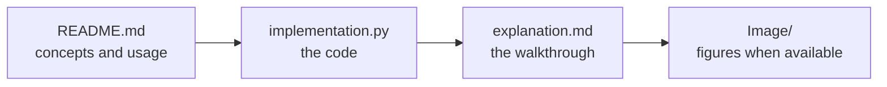
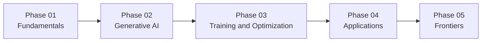

<div align="center">
  

 
<picture>
  <source media="(prefers-color-scheme: dark)" srcset="https://readme-typing-svg.demolab.com/?font=Fira+Code&size=20&duration=2800&pause=900&color=C4B5FD&center=true&vCenter=true&width=600&lines=22+Topics,+5+Phases,+One+Repo;Theory,+Code,+Explanation,+Proof;Topic+Specific+Hardware+Notes;Small+Models.+Full+Understanding." />
  
</picture>

[](LICENSE)
[](https://www.python.org/)
[](https://pytorch.org/)
[](https://huggingface.co/docs/transformers)
[](https://colab.research.google.com/)
 
[](#progress-tracker)
[](#progress-tracker)
[](https://github.com/Ayush-2703/Large_languaage_Models/commits/main)
 
[](https://github.com/Ayush-2703/Large_languaage_Models/stargazers)
[](https://github.com/Ayush-2703/Large_languaage_Models/network/members)
 
</div>
Twenty-two topics across five phases, covering large language models from self-attention and fine-tuning through RAG, alignment, and multimodal systems. The repository is in progress: use the tracker and each topic folder to see which materials are currently available. Hardware and run time depend on the example.

## Table of Contents

- [About](#about)
- [Topic Format](#topic-format)
- [Design Philosophy](#design-philosophy)
- [Curriculum](#curriculum)
- [Repository Structure](#repository-structure)
- [Scope Notes](#scope-notes)
- [Getting Started](#getting-started)
- [Progress Tracker](#progress-tracker)
- [Who This Is For](#who-this-is-for)
- [References](#references)
- [Author](#author)
- [License](#license)

---

## About 

This repository covers large language models end to end across five phases and twenty-two topics: architectural fundamentals, generative fine-tuning, efficient training and alignment, applied systems like RAG, and where the field is headed next.

The curriculum contains 22 topics across five phases. Topic material is published incrementally; the root progress table below reflects the files currently present. Most topics include a topic README, runnable implementation, and explanation. Some topic materials and generated figures are still missing, so check each folder before planning a complete course run.

Built to the same standard as its companion repository, [`Deep_Learning`](https://github.com/Ayush-2703/Deep_Learning).

**At a glance**

| Metric | Detail |
|---|---|
| Topics | 22 |
| Phases | 5 |
| Hardware | CPU/GPU requirements vary by topic; see its README |
| Run time | Depends on the model, data, and hardware |
| Models used | DistilBERT, BERT-base, GPT-2 / GPT-2-medium, T5-small / FLAN-T5-small, DistilBART, OPUS-MT |
| Datasets used | IMDB, SST-2, CNN/DailyMail or WMT16 (subsampled), SQuAD |

## Topic Format

Topics are intended to connect conceptual background, runnable code, and an explanation. The current repository does not yet use one exact four-file structure for every topic; see the progress tracker and each topic folder for its current contents.



| File | What it answers |
|---|---|
| `README.md` | What's the topic, and how do I use it? |
| `implementation.py` | Can I actually run this myself? |
| `explanation.md` | Why does the code work the way it does? |
| `Image/` | Supporting figures or outputs, when available |

Figures are supporting material and are not a substitute for checking that code runs. Results should be treated as illustrative unless a topic documents its run environment and reproducibility details.

## Design Philosophy

| Principle | What it means here |
|---|---|
| Practical examples | Implementations aim to use small models and datasets where appropriate; check each topic for hardware and run-time requirements |
| Small models, full understanding | Hands-on code uses small open checkpoints (DistilBERT, BERT-base, GPT-2 / GPT-2-medium, T5-small / FLAN-T5-small, DistilBART, OPUS-MT) and small public datasets (IMDB, SST-2, CNN/DailyMail or WMT16 subsamples, SQuAD) |
| Scales conceptually | Topic READMEs connect small runnable examples to larger systems where relevant |
| Grounded, not copied | Theory draws on Rothman's and Tunstall et al.'s books plus primary papers: paraphrased throughout, cited by title and author, never block-quoted |

## Curriculum



### 📖 Phase 01 · Review of Fundamental LLMs

| # | Topic | Folder |
|---|---|---|
| 1 | History and Evolution of Language Models | [`01-History-and-Evolution-of-Language-Models`](https://github.com/Ayush-2703/Large_languaage_Models/tree/main/01-Fundamental_LLMs/01-History_and_Evolution) |
| 2 | Transformer Architecture and Self-Attention Mechanism (QKV math) | [`02-Transformer-Architecture-and-Self-Attention`](https://github.com/Ayush-2703/Large_languaage_Models/tree/main/01-Fundamental_LLMs/02-Transformer_and_Self_Attention) |
| 3 | Pretraining vs. Fine-Tuning Paradigms | [`03-Pretraining-vs-Fine-Tuning-Paradigms`](https://github.com/Ayush-2703/Large_languaage_Models/tree/main/01-Fundamental_LLMs/03-Pretraining_vs_Fine_Tuning) |
| 4 | Scaling Laws and Model Efficiency | [`04-Scaling-Laws-and-Model-Efficiency`](https://github.com/Ayush-2703/Large_languaage_Models/tree/main/01-Fundamental_LLMs/04-Scaling_Laws_and_Model_Efficiency) |
| 5 | Ethical Considerations in Large-Scale AI | [`05-Ethical-Considerations-in-Large-Scale-AI`](https://github.com/Ayush-2703/Large_languaage_Models/tree/main/01-Fundamental_LLMs/05-Ethical_Considerations) |

### 🎛️ Phase 02 · Generative AI with LLMs

| # | Topic | Folder |
|---|---|---|
| 1 | Principles and Techniques for Fine-Tuning Pretrained Models | [`01-Fine-Tuning-Principles-and-Techniques`](02-Generative_AI_with_LLMs/01-Fine_Tuning_Principles_and_Techniques/) |
| 2 | Transfer Learning for Domain-Specific Tasks | [`02-Transfer-Learning-for-Domain-Specific-Tasks`](02-Generative_AI_with_LLMs/02-Transfer_Learning_for_Domain_Specific_Tasks/) |
| 3 | Implementing Fine-Tuning (GPT, BERT, T5) | [`03-Implementing-Fine-Tuning-GPT-BERT-T5`](02-Generative_AI_with_LLMs/03-Implementing_Fine_Tuning/) |
| 4 | Case Studies: Text Summarization, Translation, and Sentiment Analysis | [`04-Case-Studies-Summarization-Translation-Sentiment`](02-Generative_AI_with_LLMs/04-Case_Studies_Summarization_Translation_Sentiment/) |

### ⚙️ Phase 03 · Training and Optimization of LLMs

| # | Topic | Folder |
|---|---|---|
| 1 | Data Collection and Preprocessing for LLMs | [`01-Data-Collection-and-Preprocessing`](03-Training_and_Optimization/01-Data_Collection_and_Preprocessing/) |
| 2 | Efficient Training Strategies: LoRA, QLoRA, Quantization (INT8/NF4), and Pruning | [`02-Efficient-Training-LoRA-QLoRA-Quantization-Pruning`](03-Training_and_Optimization/02-Efficient_Training/) |
| 3 | Alignment Methodologies: RLHF & DPO | [`03-Alignment-RLHF-and-DPO`](03-Training_and_Optimization/03-Alignment/) |
| 4 | Memory and Computational Challenges (Gradient Checkpointing, Flash Attention) | [`04-Memory-and-Computational-Challenges`](03-Training_and_Optimization/04-Memory_and_Computational_Challenges/) |

### 🧰 Phase 04 · Applications and Use Cases

| # | Topic | Folder |
|---|---|---|
| 1 | Introduction to Retrieval-Augmented Generation (RAG) with Vector DBs | [`01-Retrieval-Augmented-Generation-RAG-Vector-DBs`](04-Applications_and_Use_Cases/01-RAG_Vector_DBs/) |
| 2 | Integrating External Knowledge into LLMs | [`02-Integrating-External-Knowledge-into-LLMs`](04-Applications_and_Use_Cases/02-Integrating_External_Knowledge/) |
| 3 | Chain-of-Thought (CoT) Prompting and Few-Shot Learning | [`03-Chain-of-Thought-Prompting-and-Few-Shot-Learning`](04-Applications_and_Use_Cases/03-Chain_of_Thought_Prompting_and_Few_Shot_Learning/) |
| 4 | Conversational AI, Chatbots, and Knowledge Extraction | [`04-Conversational-AI-Chatbots-Knowledge-Extraction`](04-Applications_and_Use_Cases/04-AI_Chatbots_Knowledge_Extraction/) |

### 🔭 Phase 05 · Frontiers and Future of LLMs

| # | Topic | Folder |
|---|---|---|
| 1 | Emergent Behaviors and Scaling Hypotheses | [`01-Emergent-Behaviors-and-Scaling-Hypotheses`](05-Frontiers_and_Future_of_LLMs/01-Emergent_Behaviors_and_Scaling_Hypotheses/) |
| 2 | Multilingual and Cross-lingual Capabilities | [`02-Multilingual-and-Cross-lingual-Capabilities`](05-Frontiers_and_Future_of_LLMs/02-lingual_Capabilities/) |
| 3 | LLMs in Low-Resource Settings | [`03-LLMs-in-Low-Resource-Settings`](05-Frontiers_and_Future_of_LLMs/03-Low_Resource_Settings/) |
| 4 | Alignment and Controllability of LLMs | [`04-Alignment-and-Controllability-of-LLMs`](05-Frontiers_and_Future_of_LLMs/04-Alignment_and_Controllability/) |
| 5 | Beyond Text: LLMs in Robotics, Vision-Language Models, and Decision-Making | [`05-Beyond-Text-Robotics-Vision-Language-Decision-Making`](05-Frontiers_and_Future_of_LLMs/05-Beyond_Text_Robotics_Vision_Language_Decision_Making/) |

## Repository Structure

```
Large_languaage_Models/
├── README.md
├── requirements.txt
├── .gitignore
├── LICENSE
├── 01-Fundamental_LLMs/
├── 02-Generative_AI_with_LLMs/
├── 03-Training_and_Optimization/
├── 04-Applications_and_Use_Cases/
└── 05-Frontiers_and_Future_of_LLMs/
```

Each phase folder contains numbered topic folders. The common files are a topic `README.md`, `implementation.py`, and `explanation.md`; supporting images and result files vary by topic:

```
03-Training-and-Optimization-of-LLMs/
└── 02-Efficient-Training-LoRA-QLoRA-Quantization-Pruning/
    ├── README.md           # Topic concepts and usage
    ├── implementation.py   # Runnable PyTorch + Hugging Face code
    ├── explanation.md      # Line-by-line walkthrough of the code's why and what
    └── Image               # Generated artifact proving the code ran end to end
```

## Scope Notes

> [!NOTE]
> Standalone Flash Attention kernels need Ampere-class GPUs or newer, so they won't run on a T4. Check the memory and computational challenges topic README for the implementation's actual backend and hardware requirements.
>
> Full RLHF (reward model plus PPO rollouts) can be expensive to run. Check the Alignment topic README for the exact hands-on scope and hardware requirements.

## Getting Started

```bash
git clone https://github.com/Ayush-2703/Large_languaage_Models.git
cd Large_languaage_Models
python -m venv venv
source venv/bin/activate        # Windows: venv\Scripts\activate
pip install -r requirements.txt
```

> [!TIP]
> **Running on Google Colab:** clone this repository or open a topic implementation in a notebook. Review that topic's README for its dependencies, data downloads, and hardware requirements before running it.

## Progress Tracker

| Phase | Topics | Completed | Progress |
|---|---|---|---|
| 01 · Fundamental LLMs | 5 | 5 | 5/5 have README, implementation, and explanation |
| 02 · Generative AI with LLMs | 4 | 3 | 3/4 have README, implementation, and explanation |
| 03 · Training and Optimization | 4 | 4 | 4/4 have README, implementation, and explanation |
| 04 · Applications and Use Cases | 4 | 4 | 4/4 have README, implementation, and explanation |
| 05 · Frontiers and Future | 5 | 5 | 5/5 have README, implementation, and explanation |
| **Total** | **22** | **21** | **21/22 have the three core files** |

The counts describe file presence, not execution or completeness of the scientific content. Phase 02, topic 04 currently has a README only.

## Who This Is For

- You're comfortable with Python and have touched PyTorch, but self-attention has always been something you nodded along to rather than derived by hand.
- You want to say you've implemented LoRA, DPO, and a RAG pipeline, not just read a blog post about them.
- You want to learn with practical examples and can adapt the hardware to the requirements listed for each topic.
- You'd rather work through 22 focused topics with real, runnable code than sit through 22 hours of lecture slides.

## References

- Rothman, Denis. *Transformers for Natural Language Processing*
- Tunstall, Lewis, Leandro von Werra, and Thomas Wolf. *Natural Language Processing with Transformers*
- Primary papers are cited in topic materials where available

Check the individual topic README and explanation for its references.

---
## 📜 License

Distributed under the **MIT License**. See [`LICENSE`](LICENSE) for details.  
You're free to use, fork, and build on this for personal and commercial projects.

---

## 👤 Author

<div align="center">

### Ayush Kumar Singh

*Entry-level engineer in AI, ML, DL, GenAI, LLM, NLP, Adversarial ML, Geospatial AI Systems*<br>
Building practical ML systems with careful evaluation and clear, reproducible engineering.

[](https://github.com/Ayush-2703)
[](https://linkedin.com/in/ayushsingh2703)
[](mailto:ab49ayush@gmail.com)

</div>

---

<div align="center">

**If this repository helped you, please consider giving it a ⭐**  
*It takes 2 seconds and helps others discover it.*


</div>

